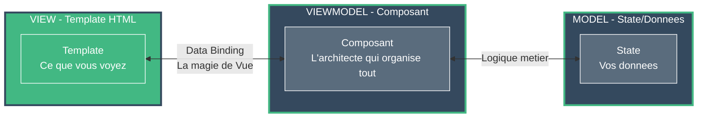
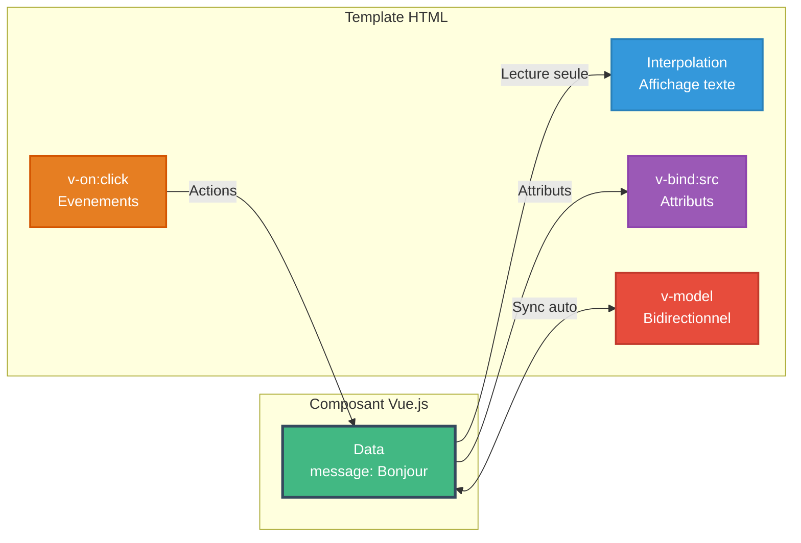
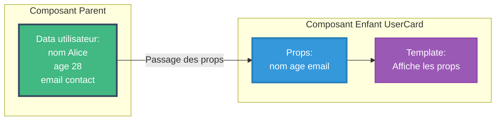
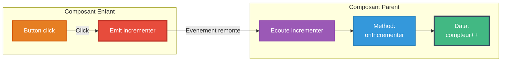
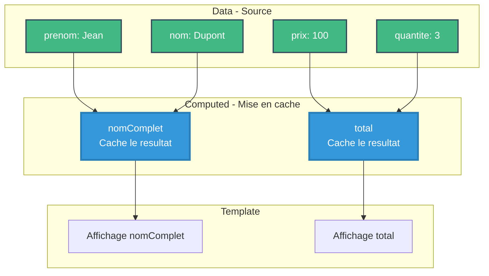
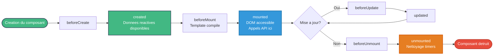

<a name="module1-introduction" id="module1-introduction"></a>

# Module 1
## Introduction à Vue.js et bases fondamentales

---

# SOMMAIRE DU MODULE

<div class="flex flex-col gap-2">
<Link to="rappels-javascript">🎯 1.1 Rappels JavaScript ES6+</Link>
<Link to="architecture">🏗️ 1.2 Architecture Vue.js</Link>
<Link to="outils-environnement">🛠️ 1.3 Outils et environnement</Link>
<Link to="premier-composant">🧩 1.4 Votre premier composant Vue</Link>
<Link to="directives">⚡ 1.5 Directives et data binding</Link>
<Link to="communication-entre-composants">💬 1.6 Communication entre composants</Link>
<Link to="proprietes-calculees">🔄 1.7 Réactivité avancée</Link>
<Link to="cycle-de-vie-des-composants">♻️ 1.8 Cycle de vie des composants</Link>
</div>

<br>

<Link to="module1-exercices">💪 Exercices Pratiques du Module 1</Link>

---
layout: default
routeAlias: "rappels-javascript"
---

<a name="rappels-javascript" id="rappels-javascript"></a>

# 1.1 Rappels JavaScript ES6+

<br>

## Arrow Functions

Les fonctions fléchées offrent une syntaxe plus concise et un binding lexical de `this`

```javascript
// Fonction traditionnelle
function addition(a, b) {
  return a + b;
}

// Arrow function
const addition = (a, b) => a + b;

// Avec bloc
const calculer = (a, b) => {
  const resultat = a + b;
  return resultat;
};
```

---

# Arrow Functions - Cas d'usage (1/2)

Méthodes de tableaux avec arrow functions

```javascript
// Dans les méthodes de tableaux
const nombres = [1, 2, 3, 4, 5];

const doubles = nombres.map(n => n * 2);
// [2, 4, 6, 8, 10]

const pairs = nombres.filter(n => n % 2 === 0);
// [2, 4]

const somme = nombres.reduce((acc, n) => acc + n, 0);
// 15
```

---

# Arrow Functions - Cas d'usage (2/2)

Binding lexical de `this`

```javascript
// Binding lexical de 'this'
class Composant {
  constructor() {
    this.valeur = 42;
  }
  
  methode = () => {
    console.log(this.valeur); // 42
  }
}
```

---

# Destructuring - Objets

Le destructuring permet d'extraire des valeurs des objets et tableaux

```javascript
// Destructuring d'objet
const utilisateur = {
  nom: 'Dupont',
  prenom: 'Jean',
  age: 30,
  email: 'jean@example.com'
};

const { nom, prenom } = utilisateur;
console.log(nom); // 'Dupont'

// Avec renommage
const { nom: nomFamille } = utilisateur;
console.log(nomFamille); // 'Dupont'
```

---

# Destructuring - Tableaux et cas avancés

```javascript
// Destructuring de tableau
const nombres = [1, 2, 3, 4, 5];
const [premier, deuxieme, ...reste] = nombres;
console.log(premier); // 1
console.log(reste); // [3, 4, 5]

// Dans les paramètres de fonction
const afficherUtilisateur = ({ nom, prenom }) => {
  console.log(`${prenom} ${nom}`);
};

// Valeurs par défaut
const { age = 18 } = utilisateur;
```

---

# Modules ES6

Les modules permettent d'organiser et de réutiliser le code

```javascript
// exports nommés (math.js)
export const PI = 3.14159;
export const addition = (a, b) => a + b;
export const multiplication = (a, b) => a * b;

// export par défaut (utilisateur.js)
export default class Utilisateur {
  constructor(nom) {
    this.nom = nom;
  }
}
```

---

# Imports de modules

```javascript
// Import nommé
import { PI, addition } from './math.js';
console.log(addition(2, 3)); // 5

// Import par défaut
import Utilisateur from './utilisateur.js';
const user = new Utilisateur('Jean');

// Import avec alias
import { addition as add } from './math.js';

// Import tout
import * as Math from './math.js';
console.log(Math.PI);
```

---

# Promises - Gestion asynchrone

Les Promises représentent une valeur qui peut être disponible maintenant, plus tard, ou jamais

<small>

```javascript
// Création d'une Promise
const fetchData = () => {
  return new Promise((resolve, reject) => {
    setTimeout(() => {
      const data = { id: 1, nom: 'Produit' };
      resolve(data);
      // ou reject(new Error('Erreur'));
    }, 1000);
  });
};

// Utilisation
fetchData()
  .then(data => console.log(data))
  .catch(error => console.error(error))
  .finally(() => console.log('Terminé'));
```

</small>

---

# Async / Await

Syntaxe plus claire pour gérer les opérations asynchrones

<small>

```javascript
// Fonction asynchrone
const chargerUtilisateur = async (id) => {
  try {
    const response = await fetch(`/api/users/${id}`);
    const data = await response.json();
    return data;
  } catch (error) {
    console.error('Erreur:', error);
    throw error;
  }
};

// Utilisation
const utilisateur = await chargerUtilisateur(1);
console.log(utilisateur);
```

</small>

---

# Async / Await - Opérations parallèles

<small>

```javascript
// Opérations séquentielles (lent)
const user = await fetchUser();
const posts = await fetchPosts();
const comments = await fetchComments();

// Opérations parallèles (rapide)
const [user, posts, comments] = await Promise.all([
  fetchUser(),
  fetchPosts(),
  fetchComments()
]);

// Promise.race - première qui se termine
const resultat = await Promise.race([
  fetchFromAPI1(),
  fetchFromAPI2()
]);
```

</small>

---
layout: new-section
routeAlias: "architecture"
---

<a name="architecture" id="architecture"></a>

# 1.2 Architecture Vue.js

---

# Présentation de Vue.js

**Vue.js** est un framework JavaScript progressif pour construire des interfaces utilisateur

### Caractéristiques principales

<small>

- 🎯 **Progressif** : peut être adopté progressivement (un composant, puis toute l'app)
- ⚡ **Performant** : Virtual DOM et réactivité optimisée
- 🔧 **Flexible** : s'adapte à tous types de projets (widget, SPA, SSR...)
- 📦 **Écosystème riche** : Vue Router, Pinia, Vite... tout est intégré harmonieusement
- 💚 **Communauté active** : support et ressources

</small>

---

# Architecture MVVM

Vue.js suit le pattern MVVM (Model-View-ViewModel)

### 🏗️ Pensez à une maison (vue, composant, state)

Nous allons voir un schéma à la slide suivante, mais pour résumer :
- VIEW : Template HTML (html)
- VIEWMODEL : Composant (script et template)
- MODEL : State / Données (data)

---

# Schéma : Architecture MVVM



---

# MVVM dans Vue.js - Exemple (1/2)

**MODEL + VIEWMODEL (Script)**

```vue
<script>
export default {
  // MODEL - Données
  data() {
    return {
      compteur: 0,
      utilisateur: {
        nom: 'Jean',
        email: 'jean@example.com'
      }
    }
  },
  // VIEWMODEL - Logique
  methods: {
    incrementer() {
      this.compteur++;
    }
  }
}
</script>
```

---

# MVVM dans Vue.js - Exemple (2/2)

**VIEW (Template)**

```vue
<template>
  <!-- VIEW - Interface -->
  <div>
    <h1>{{ utilisateur.nom }}</h1>
    <p>Compteur: {{ compteur }}</p>
    <button @click="incrementer">+1</button>
  </div>
</template>
```

---

# Organisation d'une application Vue

Structure typique d'un projet Vue.js moderne

```
mon-projet/
├── src/
│   ├── components/      # Composants réutilisables
│   ├── views/           # Pages/Vues
│   ├── composables/     # Logique réutilisable
│   ├── stores/          # State management (Pinia)
│   ├── router/          # Configuration des routes
│   ├── assets/          # Ressources (images, CSS)
│   ├── App.vue          # Composant racine
│   └── main.js          # Point d'entrée
├── public/              # Fichiers statiques
└── package.json         # Dépendances
```

---
layout: new-section
routeAlias: "outils-environnement"
---

<a name="outils-environnement" id="outils-environnement"></a>

# 1.3 Outils et environnement

---

# Node.js et npm

**Node.js** : environnement d'exécution JavaScript côté serveur

**npm** (Node Package Manager) : gestionnaire de paquets

```bash
# Vérifier les versions
node --version  # v20.x ou supérieur
npm --version   # v10.x ou supérieur
```

Vous pouvez utiliser nvm (Node Version Manager) pour gérer les versions de Node.js.

Je vous expliquerais en live pour l'installation de nvm et de Node.js.

Concernant les autres gestionnaires de paquets, vous pouvez utiliser pnpm, yarn, bun, etc.

- Pnpm : gestionnaire de paquets rapide et efficace, vous permez de centraliser les dépendances de vos projets.
- Yarn : gestionnaire de paquets rapide , créer par Facebook (meta)
- Bun : gestionnaire de paquets ultra rapide, mais moins mature que pnpm et yarn.

---

# Vite - Build tool moderne ⚡

**Vite** est l'outil de build recommandé pour Vue.js 3 en 2025

### 🏎️ Analogie : Vite vs Webpack

- **Webpack** = Préparer TOUS les ingrédients avant de cuisiner (lent au démarrage)
- **Vite** = Cuisiner à la demande, seulement ce dont vous avez besoin (instantané !)

<br> 

> Je vous le dis de suite, mais nous n'utiliserons plus webpack en 2026, sur aucun projets.

<br>

### Avantages de Vite

<small>

- ⚡ **Démarrage instantané** : < 1 seconde vs 30-60 sec avec Webpack
- 🔥 **Hot Module Replacement (HMR) ultra-rapide** : vos changements apparaissent instantanément
- 📦 **Build optimisé avec Rollup** : bundle de production ultra-performant
- 🎯 **Support TypeScript natif** : pas de configuration nécessaire
- 🔌 **Système de plugins extensible** : écosystème riche

</small>

---

### 💡 Fun fact

Vite signifie "rapide" en français ! Et créé par Evan You, le créateur de Vue.js lui-même 🇫🇷

```bash
# Créer un projet avec Vite (ULTRA simple)
npm create vite@latest mon-projet -- --template vue
```

avec pnpm :

```bash
pnpm create vite@latest mon-projet -- --template vue
```

On peut l'écrire de différentes façons, avec npx par exemple :

```bash
npx create-vite@latest mon-projet -- --template vue
```

<br/>

> npx est un outil qui permet d'exécuter des commandes sans installer de package globalement. Il est très pratique pour exécuter des commandes sans installer de package sur son pc.

---

# Créer un projet avec Vite

```bash
# Créer le projet
npm create vite@latest mon-app-vue -- --template vue

# Se déplacer dans le dossier
cd mon-app-vue

# Installer les dépendances
npm install

# Lancer le serveur de développement
npm run dev
```

---

# Structure d'un projet Vue

```
mon-app-vue/
├── node_modules/        # Dépendances
├── public/             
│   └── favicon.ico      # Icône du site
├── src/
│   ├── assets/          # Images, CSS, fonts
│   ├── components/      # Composants Vue
│   ├── App.vue          # Composant principal
│   └── main.js          # Point d'entrée
├── index.html           # Page HTML principale
├── package.json         # Configuration npm
├── vite.config.js       # Configuration Vite
└── README.md
```

---

# Le fichier main.js

Point d'entrée de l'application

```javascript
import { createApp } from 'vue';
import './style.css';
import App from './App.vue';

// Création de l'application
const app = createApp(App);

// Montage de l'application
app.mount('#app');
```

---

# Le fichier App.vue (1/2)

Composant racine de l'application - **Script et Template**

```vue
<script>
import HelloWorld from './components/HelloWorld.vue';

export default {
  components: {
    HelloWorld
  },
  data() {
    return {
      count: 0
    }
  }
}
</script>

<template>
  <div>
    <HelloWorld msg="Vue.js 3 + Vite" />
    <button @click="count++">
      Compteur: {{ count }}
    </button>
  </div>
</template>

<style scoped>
<!-- scoped = les styles sont uniquement appliqués à ce composant -->
button {
  padding: 10px 20px;
  font-size: 16px;
}
</style>
```

---

# Configuration Vite

Fichier `vite.config.js`

<small>

```javascript
import { defineConfig } from 'vite';
import vue from '@vitejs/plugin-vue';
import path from 'path';

export default defineConfig({
  plugins: [vue()],
  resolve: {
    alias: {
      '@': path.resolve(__dirname, './src')
    }
  },
  server: {
    port: 3000,
    open: true
  }
});
```

</small>

---

# Alias de chemins

Pour le resolve : on peut utiliser un alias pour les chemins de fichiers.

<small>

```javascript
alias: {
  '@': path.resolve(__dirname, './src')
}
```

Cela permet de simplifier les chemins de fichiers dans le code.

```javascript
import HelloWorld from '@/components/HelloWorld.vue';
```

</small>

Utile, à la place de mettre le chemin relatif : `./components/HelloWorld.vue`, on peut utiliser l'alias `@` pour le chemin `./src/components/HelloWorld.vue`.

---
layout: new-section
routeAlias: "premier-composant"
---

<a name="premier-composant" id="premier-composant"></a>

# 1.4 Votre premier composant Vue

---

# Qu'est-ce qu'un composant ?

Les composants sont des **briques réutilisables** qui encapsulent :

- 📝 Template (structure HTML)
- 🎨 Styles (CSS)  
- ⚙️ Logique (JavaScript)

### 🧱 Analogie : Les composants sont comme des Lego

- Vous **réutilisez** les mêmes briques partout
- Chaque brique a sa **responsabilité**
- Vous pouvez **assembler** ces briques de différentes façons

---

# Création d'un composant simple

Fichier `MonCompteur.vue` - **Options API**

<small>

```vue
<script>
export default {
  data() {
    return {
      compteur: 0
    }
  },
  methods: {
    incrementer() {
      this.compteur++;
    },
    decrementer() {
      this.compteur--;
    }
  }
}
</script>

<template>
  <div>
    <h2>Compteur: {{ compteur }}</h2>
    <button @click="incrementer">+</button>
    <button @click="decrementer">-</button>
  </div>
</template>

<style scoped>
button {
  padding: 10px 20px;
  margin: 5px;
  background: #42b883;
  color: white;
  border: none;
  border-radius: 4px;
  cursor: pointer;
}
</style>
```

</small>

---

# Utiliser un composant

```vue
<script>
import MonCompteur from './components/MonCompteur.vue';

export default {
  components: {
    MonCompteur
  }
}
</script>

<template>
  <div>
    <h1>Mon Application</h1>
    <MonCompteur />
    <MonCompteur />
  </div>
</template>
```

Chaque instance est **indépendante** !

---
layout: new-section
routeAlias: "directives"
---

<a name="directives" id="directives"></a>

# 1.5 Directives et data binding

---

# Directives et data binding

Nous allons parcourir les directives et les data binding de Vue.js.

Nous allons commencer par le data binding et en suite faire un petit tour sur les directives et les conditions.

---

# Liaison de données (Data Binding)

Vue.js permet de lier les données du composant au template avec l'**Options API**

### 🔌 C'est comme brancher une multiprise électrique

Imaginez que vos données sont l'électricité, et votre template est l'ampoule.
**Vue.js est la multiprise** qui les connecte automatiquement !

### Types de liaison (les 4 prises)

- **Interpolation** : `{{ variable }}` → Afficher du texte (lecture seule) 📖
- **Attributs** : `v-bind:attr="value"` ou `:attr="value"` → Modifier les attributs HTML 🎨
- **Événements** : `v-on:event="handler"` ou `@event="handler"` → Écouter les actions utilisateur 👂
- **Bidirectionnelle** : `v-model="variable"` → Synchronisation automatique ↔️

---

# Schéma : Data Binding

<div class="-mt-20" style="transform: scale(0.75); transform-origin: center;">



</div>

---

# La réactivité de Vue

**Avec Vue** : changez la variable, l'affichage se met à jour automatiquement ! ✨

C'est ça la **réactivité** : Vue observe vos données et met à jour le DOM automatiquement ! (comme React et Angular)

---

# Interpolation (Mustache) - 1/2

Affichage de données dans le template avec `{{ }}` - **Options API**

**Les données :**

```vue
<script>
export default {
  data() {
    return {
      message: 'Bonjour Vue.js!',
      nombre: 42,
      utilisateur: {
        nom: 'Dupont',
        prenom: 'Jean'
      }
    }
  }
}
</script>
```

---

# Interpolation (Mustache) - 2/2

**Utilisation dans le template :**

```vue
<template>
  <div>
    <h1>{{ message }}</h1>
    <p>Nombre: {{ nombre }}</p>
    <p>Nom complet: {{ utilisateur.prenom }} {{ utilisateur.nom }}</p>
    <p>Calcul: {{ nombre * 2 }}</p>
    <p>Méthode: {{ message.toUpperCase() }}</p>
  </div>
</template>
```

---

# Directives

Les directives sont des attributs HTML qui permettent de manipuler le DOM de manière dynamique.

Elles sont préfixées par `v-` et sont utilisées pour lier des données au template.

Voici une liste des directives que nous allons voir :

- v-bind
- v-on
- v-if
- v-else
- v-show
- v-for
- v-model

Nous verrons les autres directives dans un autre module plus tard.

---

# Directive v-bind (1/2)

Lie un attribut HTML à une expression JavaScript - **Options API**

**Les données :**

```vue
<script>
export default {
  data() {
    return {
      imageUrl: '/logo.png',
      altText: 'Logo Vue.js',
      isDisabled: false,
      styles: {
        color: 'blue',
        fontSize: '20px'
      }
    }
  }
}
</script>
```

---

# Directive v-bind (2/2)

**Utilisation dans le template :**

```vue
<template>
  
  <!-- Syntaxe courte -->
  
  
  <button :disabled="isDisabled">Cliquer</button>
  <div :style="styles">Texte stylé</div>
</template>
```

---

# Directive v-on (événements) - 1/2

Écoute les événements DOM - **Options API**

**Logique :**

```vue
<script>
export default {
  data() {
    return {
      compteur: 0,
      message: ''
    }
  },
  methods: {
    incrementer() {
      this.compteur++;
    },
    afficherMessage(event) {
      console.log('Événement:', event);
      this.message = 'Bouton cliqué!';
    }
  }
}
</script>
```

---

# Directive v-on (événements) - 2/2

**Template :**

```vue
<template>
  <button v-on:click="incrementer">+1</button>
  <!-- Syntaxe courte -->
  <button @click="compteur++">+1</button>
  <button @click="afficherMessage">Message</button>
  <p>{{ compteur }}</p>
</template>
```

---

# Modificateurs d'événements

Vue.js propose des modificateurs pour faciliter la gestion des événements

```vue
<template>
  <!-- Empêcher le comportement par défaut -->
  <form @submit.prevent="onSubmit">
    <button type="submit">Envoyer</button>
  </form>

  <!-- Stopper la propagation -->
  <div @click="handleClick">
    <button @click.stop="handleButtonClick">Cliquer</button>
  </div>

  <!-- Une seule fois -->
  <button @click.once="init">Initialiser</button>

  <!-- Combinaisons -->
  <input @keyup.enter="submit" />
  <input @keyup.ctrl.enter="send" />
</template>
```

---

# Directive v-if / v-else (1/2)

Affichage conditionnel (ajout/suppression du DOM) - **Options API**

**Données :**

```vue
<script>
export default {
  data() {
    return {
      isLoggedIn: false,
      userRole: 'admin',
      score: 75
    }
  }
}
</script>
```

---

# Directive v-if / v-else (2/2)

**Template avec conditions :**

```vue
<template>
  <div v-if="isLoggedIn">
    <h1>Bienvenue!</h1>
  </div>
  <div v-else>
    <h1>Veuillez vous connecter</h1>
  </div>

  <div v-if="userRole === 'admin'">Admin</div>
  <div v-else-if="userRole === 'user'">Utilisateur</div>
  <div v-else>Invité</div>
</template>
```

---

# Directive v-show

Alternative à `v-if` qui utilise CSS (display: none) - **Options API**

```vue
<script>
export default {
  data() {
    return {
      isVisible: true
    }
  }
}
</script>

<template>
  <div v-show="isVisible">
    Ce contenu est visible
  </div>
  
  <button @click="isVisible = !isVisible">
    Toggle
  </button>
</template>
```

---

# v-if vs v-show : La bataille ! ⚔️

### 🏗️ v-if : Le démolisseur/constructeur

- **Détruit** et **recrée** l'élément dans le DOM à chaque fois
- Comme démolir et reconstruire un mur de Lego à chaque fois
- **Coût élevé** si vous toggle souvent
- ✅ **Utilisez si** : l'élément change rarement

### 👻 v-show : Le magicien de l'invisibilité

- L'élément reste dans le DOM, juste caché avec `display: none`
- Comme mettre un drap d'invisibilité sur quelque chose
- **Coût faible** pour toggler
- ✅ **Utilisez si** : vous toggle souvent (menu dropdown, modal...)

### 🎯 Règle d'or

**Toggle fréquent** (ex: dropdown menu) → `v-show`
**Condition rare** (ex: admin panel) → `v-if`

---

# Directive v-for (1/2)

Rendu de listes - **Options API**

**Données :**

```vue
<script>
export default {
  data() {
    return {
      fruits: ['Pomme', 'Banane', 'Orange'],
      utilisateurs: [
        { id: 1, nom: 'Alice', age: 25 },
        { id: 2, nom: 'Bob', age: 30 },
        { id: 3, nom: 'Charlie', age: 35 }
      ]
    }
  }
}
</script>
```

---

# Directive v-for (2/2)

**Utilisation :**

```vue
<template>
  <!-- Tableau simple -->
  <ul>
    <li v-for="(fruit, index) in fruits" :key="index">
      {{ index + 1 }}. {{ fruit }}
    </li>
  </ul>
</template>
```

---

# v-for avec objets

```vue
<template>
  <!-- Tableau d'objets -->
  <div v-for="user in utilisateurs" :key="user.id">
    <h3>{{ user.nom }}</h3>
    <p>Âge: {{ user.age }}</p>
  </div>

  <!-- Objet -->
  <div v-for="(value, key, index) in objet" :key="key">
    {{ index }}. {{ key }}: {{ value }}
  </div>

  <!-- Nombre -->
  <span v-for="n in 10" :key="n">{{ n }} </span>
</template>
```

---

# v-for : Point important

⚠️ **Important** : toujours utiliser `:key` avec une valeur unique pour les performances

Le `:key` aide Vue à identifier chaque élément de façon unique et optimiser le rendu.

---

# v-model - Liaison bidirectionnelle (1/2)

Synchronise automatiquement les données avec les inputs - **Options API**

**Données :**

```vue
<script>
export default {
  data() {
    return {
      texte: '',
      isChecked: false,
      selected: '',
      message: ''
    }
  }
}
</script>
```

---

# v-model - Liaison bidirectionnelle (2/2)

**Template :**

```vue
<template>
  <input v-model="texte" type="text" />
  <p>Texte: {{ texte }}</p>

  <input v-model="isChecked" type="checkbox" />
  <p>Coché: {{ isChecked }}</p>

  <select v-model="selected">
    <option>A</option>
    <option>B</option>
  </select>

  <textarea v-model="message"></textarea>
</template>
```

---

# Présentation de v-model

v-model est un sucre syntaxique pour :

```vue
<!-- Ces deux lignes sont équivalentes -->
<input v-model="texte" />
<input 
  :value="texte" 
  @input="texte = $event.target.value" 
/>
```

**En fait ce principe s'appelle le two-way data binding ou le banana in the box.**

two-way c'est bidirectionnel, c'est à dire que la donnée est liée à la vue et à la vue est liée à la donnée.

Elle s'injecte dans le template, et elle est liée à la donnée, donc si on met à un jour via un input par exemple, a donnée sera mise à jour en direct.

Très connu chez Angular , donc en clair , quand vous apprenez une librarie ou un framework js moderne, vous allez pouvoir repetez la même chose. :)

---
layout: new-section
routeAlias: "communication-entre-composants"
---

<a name="communication-entre-composants" id="communication-entre-composants"></a>

# 1.6 Communication entre composants

---

# Props - Passer des données aux enfants

Les props permettent de passer des données du parent à l'enfant - **Options API**

```vue
<!-- UserCard.vue -->
<script>
export default {
  props: {
    nom: String,
    age: Number,
    email: {
      type: String,
      required: true
    }
  }
}
</script>

<template>
  <div class="card">
    <h2>{{ nom }}</h2>
    <p>Âge: {{ age }}</p>
    <p>Email: {{ email }}</p>
  </div>
</template>
```

---

# Schéma : Communication par Props



---

# Utilisation des props (1/2)

**Script avec les données :**

```vue
<script>
import UserCard from './components/UserCard.vue';

export default {
  components: {
    UserCard
  },
  data() {
    return {
      utilisateur: {
        nom: 'Alice',
        age: 28,
        email: 'alice@example.com'
      }
    }
  }
}
</script>
```

---

# Utilisation des props (2/2)

**Template - passage des props :**

```vue
<template>
  <UserCard 
    :nom="utilisateur.nom"
    :age="utilisateur.age"
    :email="utilisateur.email"
  />
  
  <!-- Spread operator -->
  <UserCard v-bind="utilisateur" />
</template>
```

---

# Validation des props (1/2)

**Types et validation de base :**

```vue
<script>
export default {
  props: {
    // Type simple
    titre: String,
    
    // Type multiple
    id: [String, Number],
    
    // Obligatoire
    nom: {
      type: String,
      required: true
    }
  }
}
</script>
```

---

# Validation des props (2/2)

**Valeurs par défaut :**

```vue
<script>
export default {
  props: {
    // Valeur par défaut
    age: {
      type: Number,
      default: 18
    },
    
    // Objet/Tableau par défaut (fonction)
    options: {
      type: Object,
      default: () => ({})
    }
  }
}
</script>
```

---

# Validation avancée des props (1/2)

**Validation personnalisée et enum :**

```vue
<script>
export default {
  props: {
    // Validation personnalisée
    email: {
      type: String,
      validator: (value) => {
        return value.includes('@');
      }
    },
    
    // Enum
    statut: {
      type: String,
      validator: (value) => {
        return ['actif', 'inactif', 'attente'].includes(value);
      }
    }
  }
}
</script>
```

---

# Validation avancée des props (2/2)

**Type personnalisé complexe :**

```vue
<script>
export default {
  props: {
    // Type personnalisé
    utilisateur: {
      type: Object,
      validator: (value) => {
        return value.hasOwnProperty('nom') && 
               value.hasOwnProperty('email');
      }
    }
  }
}
</script>
```

---

# Événements personnalisés (emit) - 1/2

Les enfants peuvent communiquer avec les parents via des événements - **Options API**

**Script du composant enfant :**

```vue
<!-- CompteurEnfant.vue -->
<script>
export default {
  emits: ['incrementer', 'decrementer'],
  methods: {
    handleIncrement() {
      this.$emit('incrementer', 1);
    },
    handleDecrement() {
      this.$emit('decrementer', 1);
    }
  }
}
</script>
```

---

# Schéma : Communication par Events



---

# Événements personnalisés (emit) - 2/2

**Template :**

```vue
<template>
  <div>
    <button @click="handleIncrement">+</button>
    <button @click="handleDecrement">-</button>
  </div>
</template>
```

---

# Écouter les événements personnalisés (1/2)

**Script du composant parent :**

```vue
<script>
import CompteurEnfant from './components/CompteurEnfant.vue';

export default {
  components: {
    CompteurEnfant
  },
  data() {
    return {
      compteur: 0
    }
  },
  methods: {
    onIncrementer(valeur) {
      this.compteur += valeur;
    },
    onDecrementer(valeur) {
      this.compteur -= valeur;
    }
  }
}
</script>
```

---

# Écouter les événements personnalisés (2/2)

**Template :**

```vue
<template>
  <div>
    <p>Compteur: {{ compteur }}</p>
    <CompteurEnfant 
      @incrementer="onIncrementer"
      @decrementer="onDecrementer"
    />
  </div>
</template>
```

---

# Validation des événements (1/2)

**Validation des types d'événements :**

```vue
<script>
export default {
  emits: {
    // Validation simple
    incrementer: (value) => {
      return typeof value === 'number' && value > 0;
    },
    decrementer: (value) => {
      return typeof value === 'number' && value > 0;
    }
  }
}
</script>
```

---

# Validation des événements (2/2)

**Validation multi-paramètres :**

```vue
<script>
export default {
  emits: {
    change: (id, value) => {
      return typeof id === 'string' && id.length > 0;
    }
  },
  methods: {
    handleIncrement() {
      this.$emit('incrementer', 1);
    }
  }
}
</script>
```

---

# Composants dynamiques (1/2)

Changer de composant dynamiquement avec `<component>`

**Script :**

```vue
<script>
import Accueil from './components/Accueil.vue';
import Profil from './components/Profil.vue';
import Parametres from './components/Parametres.vue';

export default {
  components: {
    Accueil,
    Profil,
    Parametres
  },
  data() {
    return {
      currentComponent: 'Accueil'
    }
  },
  computed: {
    components() {
      return { Accueil, Profil, Parametres };
    }
  }
}
</script>
```

---

# Composants dynamiques (2/2)

**Template :**

```vue
<template>
  <div>
    <button @click="currentComponent = 'Accueil'">Accueil</button>
    <button @click="currentComponent = 'Profil'">Profil</button>
    <button @click="currentComponent = 'Parametres'">Paramètres</button>
    
    <component :is="components[currentComponent]" />
  </div>
</template>
```

---

# Gestion de listes de composants (1/3)

**Import et données :**

```vue
<script>
import TodoItem from './components/TodoItem.vue';

export default {
  components: {
    TodoItem
  },
  data() {
    return {
      todos: [
        { id: 1, text: 'Apprendre Vue.js', done: false },
        { id: 2, text: 'Créer un projet', done: false },
        { id: 3, text: 'Déployer', done: false }
      ]
    }
  }
}
</script>
```

---

# Gestion de listes de composants (2/3)

**Méthodes :**

```vue
<script>
export default {
  methods: {
    ajouterTodo(text) {
      this.todos.push({
        id: Date.now(),
        text,
        done: false
      });
    },
    toggleTodo(todo) {
      todo.done = !todo.done;
    }
  }
}
</script>
```

---

# Gestion de listes de composants (3/3)

**Template avec v-for :**

```vue
<template>
  <TodoItem 
    v-for="todo in todos"
    :key="todo.id"
    :todo="todo"
    @toggle="toggleTodo(todo)"
  />
</template>
```

---

# Affichage conditionnel de composants (1/2)

**Script :**

```vue
<script>
import LoginForm from './components/LoginForm.vue';
import Dashboard from './components/Dashboard.vue';
import AdminPanel from './components/AdminPanel.vue';
import UserPanel from './components/UserPanel.vue';

export default {
  components: {
    LoginForm,
    Dashboard,
    AdminPanel,
    UserPanel
  },
  data() {
    return {
      isLoggedIn: false,
      userRole: 'user'
    }
  },
  methods: {
    handleLogin() {
      this.isLoggedIn = true;
    }
  }
}
</script>
```

---

# Affichage conditionnel de composants (2/2)

**Template :**

```vue
<template>
  <div>
    <LoginForm v-if="!isLoggedIn" @login="handleLogin" />
    
    <Dashboard v-else>
      <AdminPanel v-if="userRole === 'admin'" />
      <UserPanel v-else />
    </Dashboard>
  </div>
</template>
```

---
layout: new-section
routeAlias: "proprietes-calculees"
---

<a name="proprietes-calculees" id="proprietes-calculees"></a>

# 1.7 Réactivité avancée

---

# Propriétés calculées (computed) - 1/2

Les propriétés calculées sont des valeurs dérivées qui se mettent à jour automatiquement - **Options API**

**Script :**

```vue
<script>
export default {
  data() {
    return {
      prenom: 'Jean',
      nom: 'Dupont',
      prix: 100,
      quantite: 3
    }
  },
  computed: {
    nomComplet() {
      return `${this.prenom} ${this.nom}`;
    },
    total() {
      return this.prix * this.quantite;
    }
  }
}
</script>
```

---

# Schéma : Computed Properties



---

# Propriétés calculées (computed) - 2/2

**Template :**

```vue
<template>
  <p>{{ nomComplet }}</p>
  <p>Total: {{ total }}€</p>
</template>
```

---

# Computed vs Methods : Le match ! 🥊 (1/2)

### 💾 Computed : Le malin qui mémorise

Comme un étudiant qui note sa réponse et ne recalcule que si la question change !

```vue
<script>
export default {
  data() {
    return {
      nombres: [1, 2, 3, 4, 5]
    }
  },
  computed: {
    // Computed - mise en cache
    sommeComputed() {
      console.log('Calcul computed'); // Affiché 1 seule fois !
      return this.nombres.reduce((a, b) => a + b, 0);
    }
  },
  methods: {
    // Method - recalculé à chaque fois
const sommeMethod = () => {
  console.log('Calcul method'); // Affiché 2 fois !
  return nombres.value.reduce((a, b) => a + b, 0);
};
</script>
```

---

# Computed vs Methods : Le match ! 🥊 (2/2)

**Template :**

```vue
<template>
  <p>{{ sommeComputed }}</p> <!-- Calculé 1 fois ✨ -->
  <p>{{ sommeComputed }}</p> <!-- Cache utilisé ♻️ -->
  <p>{{ sommeMethod() }}</p> <!-- Calculé 🔄 -->
  <p>{{ sommeMethod() }}</p> <!-- Recalculé 🔄 -->
</template>
```

### 🎯 Règle d'or

**Computed** : valeur dérivée qui dépend d'autres valeurs (nom complet = prénom + nom)
**Methods** : actions/opérations (envoyer email, sauvegarder...)

---

# Observateurs (watch)

Les **watchers** permettent d'exécuter du code quand une donnée change - **Options API**

### 🎯 Quand utiliser watch ?

- **Computed** : Calculer une valeur dérivée (prénom + nom = nom complet)
- **Watch** : Effectuer une action en réponse à un changement (sauvegarder, appel API...)

```vue
<script>
export default {
  data() {
    return {
      recherche: '',
      resultats: []
    }
  },
  watch: {
    // Watcher simple
    recherche(nouvelleValeur, ancienneValeur) {
      console.log(`Recherche: ${ancienneValeur} → ${nouvelleValeur}`);
      this.chercherProduits(nouvelleValeur);
    }
  },
  methods: {
    chercherProduits(terme) {
      // Appel API...
    }
  }
}
</script>
```

---

# Watch - Options avancées

```vue
<script>
export default {
  data() {
    return {
      utilisateur: {
        nom: 'Dupont',
        prenom: 'Jean'
      },
      compteur: 0
    }
  },
  watch: {
    // Watch immédiat (exécuté au montage)
    compteur: {
      handler(newVal) {
        console.log('Compteur:', newVal);
      },
      immediate: true // ← Exécuté dès le montage
    },
    
    // Watch profond (objet imbriqué)
    utilisateur: {
      handler(newVal) {
        console.log('Utilisateur modifié:', newVal);
        this.sauvegarder();
      },
      deep: true // ← Surveille les propriétés imbriquées
    }
  }
}
</script>
```

---

# Watch vs Computed : Cas pratique

**Exemple : Recherche avec debounce**

<small>

```vue
<script>
export default {
  data() {
    return {
      searchQuery: '',
      searchResults: [],
      loading: false
    }
  },
  watch: {
    // ✅ WATCH : parfait pour les effets secondaires (API, etc.)
    searchQuery(newQuery) {
      this.loading = true;
      
      // Debounce pour éviter trop d'appels API
      clearTimeout(this.debounceTimer);
      this.debounceTimer = setTimeout(async () => {
        const response = await fetch(`/api/search?q=${newQuery}`);
        this.searchResults = await response.json();
        this.loading = false;
      }, 300);
    }
  },
  computed: {
    // ✅ COMPUTED : parfait pour les calculs
    hasResults() {
      return this.searchResults.length > 0;
    }
  }
}
</script>
```

</small>

---

# Requêtes HTTP avec fetch (1/2)

**Données :**

```vue
<script>
export default {
  data() {
    return {
      users: [],
      loading: true,
      error: null
    }
  }
}
</script>
```

---

# Requêtes HTTP avec fetch (2/2)

**Méthode et lifecycle :**

```vue
<script>
export default {
  methods: {
    async fetchUsers() {
      try {
        this.loading = true;
        const response = await fetch('https://api.example.com/users');
        
        if (!response.ok) {
          throw new Error('Erreur réseau');
        }
        
        this.users = await response.json();
      } catch (e) {
        this.error = e.message;
      } finally {
        this.loading = false;
      }
    }
  },
  mounted() {
    this.fetchUsers();
  }
}
</script>
```

---

# Requêtes POST avec fetch (1/2)

**Données du formulaire :**

```vue
<script>
export default {
  data() {
    return {
      nom: '',
      email: ''
    }
  }
}
</script>
```

---

# Requêtes POST avec fetch (2/2)

**Méthode POST :**

```vue
<script>
export default {
  methods: {
    async creerUtilisateur() {
      try {
        const response = await fetch('https://api.example.com/users', {
          method: 'POST',
          headers: {
            'Content-Type': 'application/json',
          },
          body: JSON.stringify({
            nom: this.nom,
            email: this.email
          })
        });
        
        const data = await response.json();
        console.log('Utilisateur créé:', data);
      } catch (error) {
        console.error('Erreur:', error);
      }
    }
  }
}
</script>
```

---

# Gestion des données avec axios (1/2)

Alternative à fetch (plus de fonctionnalités)

```bash
npm install axios
```

**Import et données :**

```vue
<script>
import axios from 'axios';

export default {
  data() {
    return {
      users: []
    }
  }
}
</script>
```

---

# Gestion des données avec axios (2/2)

**Méthodes GET et POST :**

```vue
<script>
export default {
  async mounted() {
    try {
      const { data } = await axios.get('/api/users');
      this.users = data;
    } catch (error) {
      console.error(error);
    }
  },
  methods: {
    async createUser(userData) {
      await axios.post('/api/users', userData);
    }
  }
}
</script>
```

---

# Bilan de compétences

### 🎯 Ce que vous savez maintenant

<small>

- ✅ **JavaScript ES6+** : Arrow functions, destructuring, modules, async/await
- ✅ **Architecture Vue.js** : MVVM, organisation d'application
- ✅ **Outils** : Node.js, Vite, structure de projet
- ✅ **Concepts fondamentaux** : Data binding, interpolation, directives
- ✅ **Composants** : Création, props, événements, dynamiques
- ✅ **Réactivité** : Computed, lifecycle, composables, requêtes HTTP

</small>

---
layout: new-section
routeAlias: "cycle-de-vie-des-composants"
---

<a name="cycle-de-vie-des-composants" id="cycle-de-vie-des-composants"></a>

# 1.8 Cycle de vie des composants

---

# Hooks du cycle de vie

Les hooks permettent d'exécuter du code à des moments précis - **Options API**

<small>

```vue
<script>
export default {
  data() {
    return {
      message: 'Hello',
      users: []
    }
  },
  beforeCreate() {
    console.log('Avant la création');
    // On peut modifier les props par exemple, même si elles sont censé être immuables.
    console.log(this.message); // undefined - les données ne sont pas encore disponibles
  },
  created() {
    console.log('Composant créé');
    // On peut accéder aux données réactives, on peut les modifier.
    this.message = 'Bonjour Vue!';
    console.log(this.message); // 'Bonjour Vue!'
  },
  beforeMount() {
    console.log('Avant le montage');
    // On peut modifier le template, on peut ajouter des éléments au DOM.
    console.log(this.$el); // undefined - le DOM n'est pas encore créé
  },
  mounted() {
    console.log('Composant monté');
    // Appels API, initialisation
    fetch('https://api.example.com/users')
      .then(response => response.json())
      .then(data => this.users = data);
    console.log(this.$el); // Accès au DOM disponible
  }
}
</script>
```

</small>

---

# Schéma : Cycle de vie des composants



---

# Hooks du cycle de vie (suite) - 1/2

**Hooks de mise à jour :**

```vue
<script>
export default {
  data() {
    return {
      compteur: 0
    }
  },
  updated() {
    console.log('Composant mis à jour');
    console.log('Nouvelle valeur:', this.compteur);
    // par exemple pour des mesures (getBoundingClientRect, scroll, etc.)
    // mais en général on utilisera plutot computed ou watch pour ce genre de choses.
    // à peu utiliser donc
  }
}
</script>
```

---

# Hooks du cycle de vie (suite) - 2/2

**Hooks de démontage :**

```vue
<script>
export default {
  beforeUnmount() {
    console.log('Avant destruction');
  },
  unmounted() {
    console.log('Composant démonté');
    // Nettoyage: timers, subscriptions, listeners
    // important de nettoyer les événements, les timers, les subscriptions, les listeners, etc si non => fuite de mémoire potentielle.
  }
}
</script>
```

---

# Exemple pratique avec lifecycle (1/2)

**Données et mounted :**

```vue
<script>
export default {
  data() {
    return {
      data: null,
      loading: true,
      interval: null
    }
  },
  async mounted() {
    // Charger des données
    try {
      const response = await fetch('/api/data');
      this.data = await response.json();
    } finally {
      this.loading = false;
    }
    
    // Démarrer un interval
    this.interval = setInterval(() => {
      console.log('Tick');
    }, 1000);
  }
}
</script>
```

---

# Exemple pratique avec lifecycle (2/2)

**Nettoyage au démontage :**

```vue
<script>
export default {
  beforeUnmount() {
    // Nettoyer l'interval
    if (this.interval) {
      clearInterval(this.interval);
    }
  }
}
</script>
```

---

# 🎯 Fil rouge : TaskFlow (notre Trello-like)

### 🎨 Ce qu'on va construire ensemble

Une application de gestion de tâches complète avec :

- 📋 **Boards** : Tableaux de tâches (Personnel, Travail, Projets)
- 📝 **Tasks** : Tâches avec titre, description, priorité
- 🏷️ **Colonnes** : À faire, En cours, Terminé
- 🎨 **Labels** : Urgent, Bug, Feature
- 👤 **Assignation** : Attribuer des tâches

<small>

### Module par module

- **Module 1** : Composants de base (Task, TaskList, TaskForm)
- **Module 2** : Slots pour composants réutilisables (TaskCard avec header/content/actions)
- **Module 3** : Directive v-drag pour drag & drop
- **Module 4** : Pinia pour centraliser l'état (tasks, boards, users)
- **Module 5** : Router pour navigation (/boards, /board/:id, /settings)
- **Module 6** : Tests de l'application

</small>

