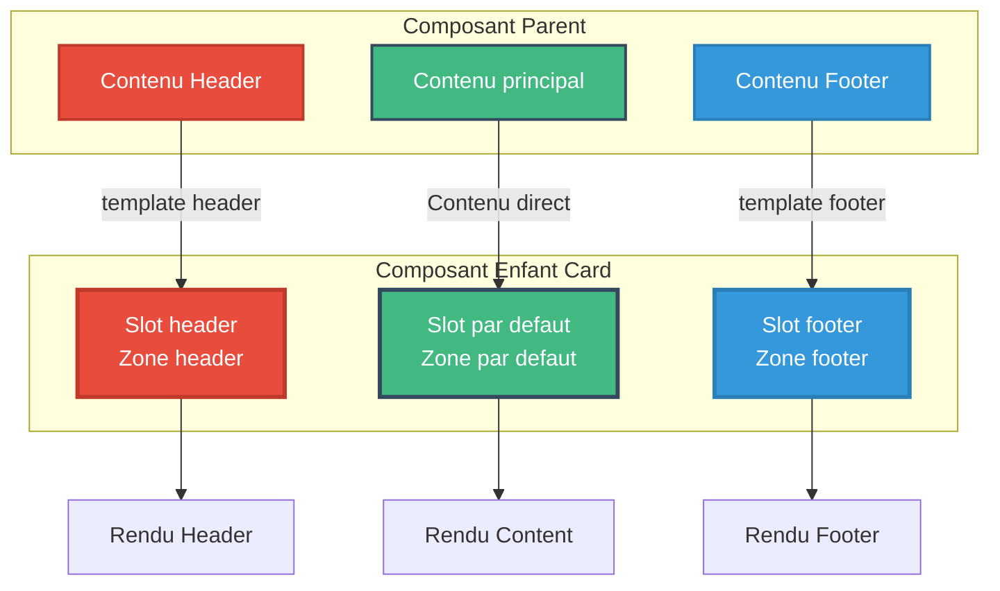
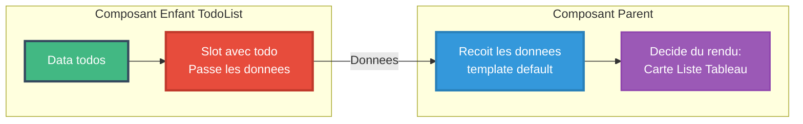

<a name="module2-slots" id="module2-slots"></a>

# Module 2
## Slots et composants génériques

---

# SOMMAIRE DU MODULE

<div class="flex flex-col gap-2">
<Link to="slots-introduction">🎰 2.1 Introduction aux slots</Link>
<Link to="slots-implementation">🛠️ 2.2 Implémentation des slots</Link>
</div>

<br>

<Link to="module2-exercices">💪 Exercices Pratiques du Module 2</Link>

---
layout: new-section
routeAlias: "slots-introduction"
---

<a name="slots-introduction" id="slots-introduction"></a>

# 2.1 Introduction aux slots

---

# Qu'est-ce qu'un slot ?

Les **slots** permettent de passer du contenu HTML (ou des composants) à un composant enfant

#### 🎰 Analogie : Les slots sont comme une machine à sous

Imaginez un **cadre photo** :
- Le cadre est votre composant (toujours le même design)
- Le **slot** est l'emplacement vide au centre
- Vous pouvez y mettre **n'importe quelle photo** !

```
┌─────────────────────┐
│  ╔═══════════════╗  │  ← Le cadre (composant)
│  ║               ║  │
│  ║   [SLOT]      ║  │  ← L'emplacement (slot)
│  ║   Mettez ce   ║  │
│  ║   que vous    ║  │
│  ║   voulez ici! ║  │
│  ╚═══════════════╝  │
└─────────────────────┘
```

---

# Pourquoi utiliser des slots ?

<small>

- 🎯 **Composants flexibles** : un composant Card pour 1000 usages différents
- 🧩 **Composer des interfaces** : assembler des briques comme des Lego
- 🎨 **Personnaliser sans casser** : chaque utilisation est unique
- ♻️ **DRY** : un seul composant Modal, 50 contenus différents

</small>

---

# Problème sans les slots

```vue
<!-- AlertSuccess.vue -->
<template>
  <div class="alert success">
    <span class="icon">✓</span>
    <span>Opération réussie</span>
  </div>
</template>

<!-- AlertError.vue -->
<template>
  <div class="alert error">
    <span class="icon">✗</span>
    <span>Une erreur est survenue</span>
  </div>
</template>
```

---

# Pourquoi c'est problématique ?

- ❌ Duplication de code
- ❌ Un composant par type de message
- ❌ Difficile à maintenir

---

# Solution avec les slots

```vue
<!-- Alert.vue - Composant générique -->
<template>
  <div class="alert">
    <span class="icon">
      <slot name="icon">ℹ️</slot>
    </span>
    <div class="content">
      <slot></slot>
    </div>
  </div>
</template>
```

---

# Utilisation du composant avec slots

```vue
<template>
  <Alert>
    <template #icon>✓</template>
    Opération réussie !
  </Alert>
  
  <Alert>
    <template #icon>✗</template>
    Une erreur est survenue
  </Alert>
  
  <Alert>
    <template #icon>⚠️</template>
    <strong>Attention :</strong> action irréversible
  </Alert>
</template>
```

---

# Avantages des slots

<small>

- ✅ Un seul composant
- ✅ Contenu flexible
- ✅ Facile à maintenir

</small>

---

# Composants génériques

Un **composant générique** est un composant réutilisable qui s'adapte à différents contextes

### Exemples de composants génériques

<small>

- 📦 **Card** : conteneur avec header, body, footer
- 🔘 **Button** : bouton personnalisable
- 📋 **Modal** : fenêtre modale
- 📰 **Layout** : mise en page avec sidebar, content, header

</small>

---

# Relations parent/enfant avec slots

Les slots nommés permettent de définir plusieurs zones d'injection de contenu.

**3 types de slots** :
- **Slot nommé** : `<slot name="header">`  
- **Slot par défaut** : `<slot>`
- **Slot nommé** : `<slot name="footer">`

---

# Schéma : Slots nommés



---
layout: new-section
routeAlias: "slots-implementation"
---

<a name="slots-implementation" id="slots-implementation"></a>

# 2.2 Implémentation

---

# Slots simples (slot par défaut)

Le slot le plus basique - un seul emplacement pour le contenu

```vue
<!-- Button.vue -->
<template>
  <button class="btn">
    <slot></slot>
  </button>
</template>

<!-- Utilisation -->
<Button>Cliquer ici</Button>
<Button>Enregistrer</Button>
<Button>
  <span class="icon">✓</span>
  Valider
</Button>
```

---

# Slot par défaut avec contenu fallback

On peut définir un contenu par défaut si rien n'est fourni

```vue
<!-- Button.vue -->
<template>
  <button class="btn">
    <slot>Bouton par défaut</slot>
  </button>
</template>

<!-- Utilisation -->
<Button>Mon texte</Button>
<!-- Rendu: Mon texte -->

<Button></Button>
<!-- Rendu: Bouton par défaut -->
```

---

# Slots nommés

Quand on a besoin de plusieurs emplacements distincts

```vue
<!-- Card.vue -->
<template>
  <div class="card">
    <header class="card-header">
      <slot name="header"></slot>
    </header>
    
    <div class="card-body">
      <slot></slot>
    </div>
    
    <footer class="card-footer">
      <slot name="footer"></slot>
    </footer>
  </div>
</template>
```

---

# Utilisation des slots nommés

```vue
<script>
import Card from './components/Card.vue';

export default {
  components: {
    Card
  }
}
</script>

<template>
  <Card>
    <template #header>
      <h2>Titre de la carte</h2>
    </template>
    
    <p>Contenu principal de la carte</p>
    <p>Encore du contenu...</p>
    
    <template #footer>
      <button>Action</button>
    </template>
  </Card>
</template>
```

---

# Directive v-slot

Syntaxes disponibles pour les slots

```vue
<!-- Syntaxe complète -->
<template v-slot:header>
  <h1>Titre</h1>
</template>

<!-- Syntaxe abrégée (recommandée) -->
<template #header>
  <h1>Titre</h1>
</template>

<!-- Slot par défaut -->
<template #default>
  <p>Contenu</p>
</template>

<!-- Ou directement -->
<p>Contenu</p>
```

---

# Scoped Slots - Introduction

Les **scoped slots** permettent au composant enfant de passer des données au parent

#### 🎁 Analogie : C'est comme une boîte cadeau avec mode d'emploi

Le composant enfant dit au parent :
> "Tiens, voici les données (le cadeau 🎁), maintenant fais-en ce que tu veux !"

### 🤔 Problème à résoudre

**Sans scoped slots** : 
- L'enfant décide TOUT (comment afficher)
- Pas flexible

**Avec scoped slots** : 
- L'enfant donne les données
- Le parent décide comment les afficher
- **Super flexible** ! 🎨

---

# Schéma : Scoped Slots



---

# Scoped Slots - Exemple concret

### Cas d'usage typique

Le composant enfant fait le **travail de récupération/logique** (ex: boucle, tri)
Le parent décide du **rendu visuel** (ex: carte, tableau, liste...)

<small>

```vue
<!-- TodoList.vue - L'enfant donne les données -->
<template>
  <ul>
    <li v-for="(todo, index) in todos" :key="todo.id">
      <slot :todo="todo" :index="index">
        <!-- Contenu par défaut si pas de slot fourni -->
        {{ todo.text }}
      </slot>
    </li>
  </ul>
</template>
```

</small>

---

# Scoped Slots - Utilisation

<small>

```vue
<script>
import TodoList from './components/TodoList.vue';

export default {
  components: {
    TodoList
  },
  data() {
    return {
      todos: [
        { id: 1, text: 'Apprendre Vue', done: true },
        { id: 2, text: 'Créer un projet', done: false }
      ]
    }
  }
}
</script>

<template>
  <TodoList :todos="todos">
    <template #default="{ todo, index }">
      <span :class="{ done: todo.done }">
        {{ index + 1 }}. {{ todo.text }}
      </span>
      <span v-if="todo.done"> ✓</span>
    </template>
  </TodoList>
</template>
```

</small>

---

# Scoped Slots - Cas avancé (1/2)

**Script du composant DataTable :**

```vue
<!-- DataTable.vue -->
<script>
export default {
  props: {
    items: {
      type: Array,
      required: true
    },
    columns: {
      type: Array,
      required: true
    }
  }
}
</script>
```

---

# Scoped Slots - Cas avancé (2/2)

**Template avec scoped slots :**

<small>

```vue
<template>
  <table>
    <thead>
      <tr>
        <th v-for="col in columns" :key="col.key">
          {{ col.label }}
        </th>
      </tr>
    </thead>
    <tbody>
      <tr v-for="item in items" :key="item.id">
        <td v-for="col in columns" :key="col.key">
          <slot 
            :name="col.key" 
            :item="item" 
            :value="item[col.key]"
          >
            {{ item[col.key] }}
          </slot>
        </td>
      </tr>
    </tbody>
  </table>
</template>
```

</small>

---

# Utilisation DataTable avec scoped slots

```vue
<template>
  <DataTable :items="users" :columns="columns">
    <template #nom="{ item }">
      <strong>{{ item.nom }}</strong>
    </template>
    
    <template #email="{ value }">
      <a :href="`mailto:${value}`">{{ value }}</a>
    </template>
    
    <template #actions="{ item }">
      <button @click="edit(item)">Éditer</button>
      <button @click="delete(item)">Supprimer</button>
    </template>
  </DataTable>
</template>
```

---

# Slots dynamiques

Les slots peuvent être déterminés dynamiquement

```vue
<script>
import Card from './components/Card.vue';

export default {
  components: {
    Card
  },
  data() {
    return {
      slotActif: 'header'
    }
  }
}
</script>

<template>
  <Card>
    <template #[slotActif]>
      Ce contenu ira dans le slot actif
    </template>
  </Card>
  
  <button @click="slotActif = 'header'">Header</button>
  <button @click="slotActif = 'footer'">Footer</button>
</template>
```

---

# Teleport : Rendu ailleurs 🚀

Le composant **Teleport** permet de rendre un composant dans une autre partie du DOM

### 🎯 Problème résolu

**Sans Teleport** :
- ❌ Les modales héritent du contexte CSS parent (z-index, overflow...)
- ❌ Difficile de gérer les overlays plein écran
- ❌ Problèmes de positionnement

**Avec Teleport** :
- ✅ Rendu directement dans `<body>` ou n'importe quel sélecteur
- ✅ Plus de problèmes de z-index
- ✅ Overlays plein écran faciles

---

# Teleport : Syntaxe

```vue
<template>
  <button @click="showModal = true">Ouvrir Modal</button>
  
  <Teleport to="body">
    <div v-if="showModal" class="modal-overlay">
      <div class="modal-content">
        <h2>Je suis rendu dans body !</h2>
        <button @click="showModal = false">Fermer</button>
      </div>
    </div>
  </Teleport>
</template>
```

---

# Teleport : Résultat dans le DOM

**Code Vue** :
```vue
<div id="app">
  <button>Ouvrir Modal</button>
  <Teleport to="body">
    <div class="modal">...</div>
  </Teleport>
</div>
```

**Rendu HTML** :
```html
<body>
  <div id="app">
    <button>Ouvrir Modal</button>
    <!-- Teleport rend ICI mais le contenu va ailleurs ! -->
  </div>
  
  <!-- Le contenu Teleport apparaît ici ! -->
  <div class="modal">...</div>
</body>
```

---

# Teleport : Cas d'usage

Les cas d'usage courants pour Teleport :

<small>

- 🎭 **Modales** : Évite les problèmes de z-index et overflow
- 📋 **Tooltips** : Positionnement absolu libre
- 🔔 **Notifications** : Toast en haut à droite de l'écran
- 🖼️ **Overlays** : Plein écran sans contraintes CSS du parent
- 🎨 **Dropdowns** : Éviter les problèmes de débordement

</small>

### 💡 Astuce

Utilisez `to="body"` pour la plupart des cas, ou un sélecteur CSS spécifique !

---

# Teleport : Rendu ailleurs 🚀

Le composant **Teleport** permet de rendre un composant dans une autre partie du DOM

### 🎯 Pourquoi Teleport ?

**Problème** : Une modale créée dans un composant enfant hérite du contexte CSS parent (z-index, overflow)

**Solution** : Teleport permet de rendre la modale directement dans `<body>` !

---

# Teleport : Syntaxe

```vue
<template>
  <button @click="showModal = true">Ouvrir</button>
  
  <Teleport to="body">
    <div v-if="showModal" class="modal-overlay">
      <div class="modal-content">
        <h2>Je suis rendu dans body !</h2>
        <button @click="showModal = false">Fermer</button>
      </div>
    </div>
  </Teleport>
</template>
```

### Résultat dans le DOM

Le contenu du `<Teleport>` est téléporté directement dans `<body>`, pas dans le composant parent !

---

# Teleport : Cas d'usage

- 🎭 **Modales** : Éviter les problèmes de z-index et overflow
- 📋 **Tooltips** : Positionnement absolu libre
- 🔔 **Notifications** : Toast/snackbar en haut à droite
- 🖼️ **Overlays** : Plein écran sans contraintes CSS du parent

### 💡 Conseil

Utilisez `to="body"` pour la plupart des cas !

---

# Combinaison Props & Slots

Les slots et props travaillent ensemble pour créer des composants puissants

<small>

```vue
<!-- Modal.vue -->
<script>
export default {
  props: {
    show: Boolean,
    title: String,
    size: {
      type: String,
      default: 'medium'
    }
  },
  emits: ['close'],
  methods: {
    handleClose() {
      this.$emit('close');
    }
  }
}
</script>
```

</small>

---

# Modal - Template

<small>

```vue
<template>
  <Teleport to="body">
    <div v-if="show" class="modal-overlay" @click="handleClose">
      <div 
        class="modal-content" 
        :class="`modal-${size}`"
        @click.stop
      >
        <header class="modal-header">
          <slot name="header">
            <h2>{{ title }}</h2>
          </slot>
          <button @click="handleClose">×</button>
        </header>
        
        <div class="modal-body">
          <slot></slot>
        </div>
        
        <footer class="modal-footer">
          <slot name="footer">
            <button @click="handleClose">Fermer</button>
          </slot>
        </footer>
      </div>
    </div>
  </Teleport>
</template>
```

</small>

---

# Utilisation du Modal

```vue
<script>
import Modal from './components/Modal.vue';

export default {
  components: {
    Modal
  },
  data() {
    return {
      showModal: false
    }
  },
  methods: {
    confirmer() {
      // Logique de confirmation
      this.showModal = false;
    }
  }
}
</script>

<template>
  <button @click="showModal = true">Ouvrir Modal</button>
  
  <Modal 
    :show="showModal" 
    title="Confirmation"
    size="small"
    @close="showModal = false"
  >
    <p>Êtes-vous sûr de vouloir continuer ?</p>
    
    <template #footer>
      <button @click="showModal = false">Annuler</button>
      <button @click="confirmer">Confirmer</button>
    </template>
  </Modal>
</template>
```

---

# Exemple : Composant Layout

```vue
<!-- AppLayout.vue -->
<template>
  <div class="app-layout">
    <aside class="sidebar">
      <slot name="sidebar"></slot>
    </aside>
    
    <div class="main-content">
      <header class="header">
        <slot name="header"></slot>
      </header>
      
      <main class="content">
        <slot></slot>
      </main>
      
      <footer class="footer">
        <slot name="footer"></slot>
      </footer>
    </div>
  </div>
</template>
```

---

# Utilisation du Layout

```vue
<template>
  <AppLayout>
    <template #sidebar>
      <nav>
        <a href="/">Accueil</a>
        <a href="/produits">Produits</a>
        <a href="/contact">Contact</a>
      </nav>
    </template>
    
    <template #header>
      <h1>Mon Application</h1>
      <UserMenu />
    </template>
    
    <!-- Contenu principal -->
    <div>
      <h2>Bienvenue</h2>
      <p>Contenu de la page...</p>
    </div>
    
    <template #footer>
      <p>© 2025 Mon Application</p>
    </template>
  </AppLayout>
</template>
```

---

# Bonnes pratiques - Slots

### ✅ Faire

<small>

- Utiliser des noms de slots descriptifs
- Fournir du contenu fallback pertinent
- Documenter les props des scoped slots
- Utiliser TypeScript pour typer les slots

</small>

### ❌ Éviter

<small>

- Trop de slots dans un seul composant (> 5)
- Noms de slots génériques (slot1, slot2...)
- Slots obligatoires sans fallback
- Logique complexe dans les slots

</small>

---

# Pattern de composition avec slots

```vue
<!-- BaseButton.vue -->
<template>
  <button class="btn" :class="variant">
    <span v-if="$slots.icon" class="icon">
      <slot name="icon"></slot>
    </span>
    <slot></slot>
    <span v-if="loading" class="spinner"></span>
  </button>
</template>

<!-- Utilisation -->
<BaseButton variant="primary">
  <template #icon>
    <IconSave />
  </template>
  Enregistrer
</BaseButton>
```

---

# Détection de slots

Vérifier si un slot est fourni

```vue
<script>
export default {
  computed: {
    hasHeader() {
      return !!this.$slots.header;
    },
    hasFooter() {
      return !!this.$slots.footer;
    }
  }
}
</script>

<template>
  <div class="card">
    <header v-if="hasHeader" class="header">
      <slot name="header"></slot>
    </header>
    
    <div class="body">
      <slot></slot>
    </div>
    
    <footer v-if="hasFooter" class="footer">
      <slot name="footer"></slot>
    </footer>
  </div>
</template>
```

---

# Slots multiples avec v-for

```vue
<!-- Accordion.vue -->
<script>
export default {
  props: {
    items: {
      type: Array,
      required: true
    }
  }
}
</script>

<template>
  <div class="accordion">
    <div 
      v-for="(item, index) in items" 
      :key="item.id"
      class="accordion-item"
    >
      <slot 
        name="item" 
        :item="item" 
        :index="index"
      >
        <div class="default-item">
          {{ item.title }}
        </div>
      </slot>
    </div>
  </div>
</template>
```

---

# Résumé du Module 2

✅ **Concepts** : Slots, composants génériques, relations parent/enfant

✅ **Slots simples** : Slot par défaut, contenu fallback

✅ **Slots nommés** : Plusieurs emplacements, directive v-slot

✅ **Scoped slots** : Passage de données enfant → parent

✅ **Slots dynamiques** : Détermination dynamique des slots

✅ **Props & Slots** : Combinaison pour composants puissants

---

# Cas d'usage des slots

| Type de slot | Cas d'usage |
|-------------|-------------|
| **Slot simple** | Contenu unique flexible (Button, Badge) |
| **Slots nommés** | Multiples zones (Card, Modal, Layout) |
| **Scoped slots** | Personnalisation du rendu (DataTable) |
| **Slots dynamiques** | UI configurable dynamiquement |

---
layout: new-section
---

# 🎯 Exercices Fil Rouge TaskFlow
## Module 2

Créons les composants réutilisables avec slots !

---

# 🎯 Exercice 1 : TaskCard.vue

Créez une carte flexible avec slots nommés

### Props

- `variant` : 'default' | 'success' | 'warning' | 'danger'
- `padding` (Boolean)

### Slots nommés

- `header` : En-tête personnalisable
- `default` : Contenu principal
- `actions` : Boutons d'actions
- `footer` : Pied de page

### Comportement

- N'afficher le header que si `$slots.header` existe
- Border-left colorée selon le variant

### 💡 Correction

👉 **Module 2 - Exercices** OU `taskflow-app/src/components/TaskCard.vue`

---

# 🎯 Exercice 2 : BoardColumn.vue

Créez une colonne Kanban avec scoped slots

#### Props

- `title` (String, required)
- `tasks` (Array)
- `color` (String, default: '#3b82f6')

#### Scoped slot `task`

Exposer : `task`, `index`, `isFirst`, `isLast`

#### Slots nommés

- `header` (scoped: title, count)
- `empty` : Message si aucune tâche

#### Bonus

Drag & drop : `@dragstart`, `@drop`, `@dragover`, classe `.drag-over`

### 💡 Correction

👉 **Module 2 - Exercices** OU `taskflow-app/src/components/BoardColumn.vue`

---

# 🎯 Exercice 3 : TaskModal.vue

Créez une modale avec Teleport et slots

#### Props

- `modelValue` (Boolean) : Pour v-model
- `size` : 'small' | 'medium' | 'large'
- `closable` (Boolean)

#### Structure

```vue
<Teleport to="body">
  <Transition name="modal">
    <div v-if="modelValue" class="modal-overlay">
      <!-- Slots : title, default, footer -->
    </div>
  </Transition>
</Teleport>
```

#### Event

- `update:modelValue` : Pour fermer la modale

#### 💡 Correction

👉 **Module 2 - Exercices** OU `taskflow-app/src/components/TaskModal.vue`

---

# Travaux pratiques - Module 2

### Exercices à réaliser

1. 🎴 **Card générique** : Créer une carte avec header/body/footer
2. 📋 **Modal réutilisable** : Modal avec slots et props
3. 📊 **DataTable** : Tableau avec colonnes customisables
4. 🎨 **Layout** : Page layout avec sidebar/header/content/footer

### Projet fil rouge

Enrichir l'application de produits avec des composants génériques
