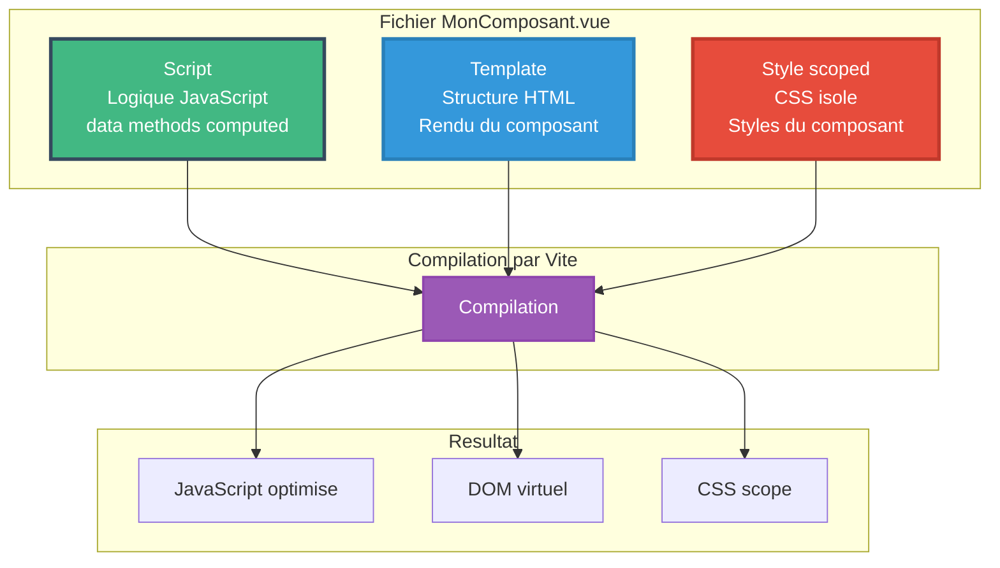
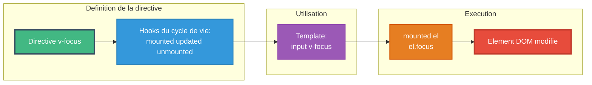

# Module 3
## Vue.js - Fonctionnement avancé

---

# SOMMAIRE DU MODULE

<div class="flex flex-col gap-2">
<Link to="sfc-components">📦 3.1 Single File Components</Link>
<Link to="directives-personnalisees">🎯 3.2 Directives personnalisées</Link>
</div>

---
layout: new-section
routeAlias: "sfc-components"
---

<a name="sfc-components" id="sfc-components"></a>

# 3.1 Single File Components (SFC)

---

# Single File Components (SFC)

Les **SFC** sont des fichiers `.vue` contenant template, script et style

### Avantages des SFC

- 📦 Encapsulation complète
- 🎨 Scoped CSS
- 🔧 Syntaxe spécifique à Vue
- ⚡ Hot Module Replacement
- 📝 Support IDE excellent

---

# Schéma : Architecture SFC



---

# Structure d'un SFC

```vue
<script>
export default {
  data() {
    return {
      count: 0
    }
  }
}
</script>

<template>
  <!-- Template du composant -->
  <div>
    <p>{{ count }}</p>
    <button @click="count++">Increment</button>
  </div>
</template>

<style scoped>
/* Styles scopés au composant */
div {
  padding: 20px;
}

button {
  background: #42b883;
  color: white;
}
</style>
```

---

# SFC - Ordre des sections

L'ordre recommandé (mais flexible) :

```vue
<!-- 1. Script -->
<script>
// Imports, logique, configuration
export default {
  // Configuration du composant
}
</script>

<!-- 2. Template -->
<template>
  <!-- Structure HTML -->
</template>

<!-- 3. Style -->
<style scoped>
/* CSS du composant */
</style>
```

---

# Options API - Structure classique

L'Options API offre une structure claire et intuitive

```vue
<script>
export default {
  data() {
    return {
      count: 0
    };
  },
  computed: {
    double() {
      return this.count * 2;
    }
  },
  methods: {
    increment() {
      this.count++;
    }
  }
};
</script>
```

**💡 Note :** Pour des cas d'usage avancés, Vue 3 propose aussi la Composition API disponible en module bonus

---

# Scoped CSS

Le CSS scopé ne s'applique qu'au composant actuel

```vue
<style scoped>
/* Ne s'applique qu'à ce composant */
.button {
  background: #42b883;
}

/* Sélecteur profond - affecte les enfants */
:deep(.child-class) {
  color: red;
}

/* Sélecteur slotted - pour le contenu des slots */
:slotted(.slot-content) {
  font-weight: bold;
}

/* Sélecteur global dans scoped */
:global(.global-class) {
  margin: 0;
}
</style>
```

---

# CSS Modules

Alternative au scoped CSS

```vue
<style module>
.container {
  padding: 20px;
}

.title {
  font-size: 24px;
  color: #42b883;
}
</style>

<template>
  <div :class="$style.container">
    <h1 :class="$style.title">Titre</h1>
  </div>
</template>
```

---

# Multiple styles dans un SFC

```vue
<template>
  <div class="container">
    <h1 class="global-title">Titre</h1>
  </div>
</template>

<!-- Styles scopés -->
<style scoped>
.container {
  padding: 20px;
}
</style>

<!-- Styles globaux -->
<style>
.global-title {
  font-family: 'Arial', sans-serif;
}
</style>

<!-- CSS Module -->
<style module="classes">
.special {
  color: red;
}
</style>
```

---

# Variables CSS réactives

Lier des variables JavaScript aux variables CSS

```vue
<script>
export default {
  data() {
    return {
      color: '#42b883',
      size: 20
    }
  }
}
</script>

<template>
  <div class="dynamic">
    <p>Texte avec couleur dynamique</p>
    <input v-model="color" type="color" />
  </div>
</template>

<style scoped>
.dynamic {
  color: v-bind(color);
  font-size: v-bind(size + 'px');
}
</style>
```

---

# Preprocesseurs CSS

Support natif pour Sass, Less, Stylus

```vue
<style lang="scss" scoped>
$primary-color: #42b883;

.container {
  background: $primary-color;
  
  .title {
    font-size: 24px;
    
    &:hover {
      opacity: 0.8;
    }
  }
  
  @media (max-width: 768px) {
    padding: 10px;
  }
}
</style>
```

---

# TypeScript dans les SFC

**💡 Note :** Vue 3 supporte TypeScript de manière native. Voir module bonus pour plus de détails.

```vue
<script>
// Exemple équivalent en JavaScript
export default {
  data() {
    return {
      user: {
        id: 1,
        nom: 'Alice',
        email: 'alice@example.com'
      }
    }
  },
  computed: {
    displayName() {
      return this.user.nom.toUpperCase();
    }
  },
  methods: {
    updateUser(newUser) {
      this.user = newUser;
    }
  }
}
</script>
```

---

# Props validés avec JavaScript

```vue
<script>
export default {
  props: {
    nom: {
      type: String,
      required: true
    },
    age: {
      type: Number,
      default: 18
    },
    isActive: {
      type: Boolean,
      required: true
    },
    tags: {
      type: Array,
      default: () => []
    }
  },
  emits: {
    update: (value) => typeof value === 'string',
    delete: (id) => typeof id === 'number'
  }
}
</script>
```

---
layout: new-section
routeAlias: "directives-personnalisees"
---

<a name="directives-personnalisees" id="directives-personnalisees"></a>

# 3.2 Directives personnalisées

---

# Qu'est-ce qu'une directive ?

Les directives sont des attributs spéciaux qui modifient le comportement des éléments DOM

### Directives natives Vue.js

- `v-if` / `v-show`
- `v-for`
- `v-bind` (`:`)
- `v-on` (`@`)
- `v-model`
- `v-html` / `v-text`
- `v-cloak`
- `v-pre` / `v-once`

---

# Directives natives - v-html

Rend du HTML brut (⚠️ attention XSS)

```vue
<script>
export default {
  data() {
    return {
      htmlContent: '<strong>Texte en gras</strong>'
    }
  }
}
</script>

<template>
  <div v-html="htmlContent"></div>
</template>
```

---

# Directives natives - v-once

Rend l'élément une seule fois (pas de réactivité)

```vue
<script>
export default {
  data() {
    return {
      message: 'Initial'
    }
  }
}
</script>

<template>
  <p v-once>{{ message }}</p>
  <!-- Restera "Initial" même si message change -->
  
  <p>{{ message }}</p>
  <!-- Se met à jour -->
  
  <button @click="message = 'Modifié'">Changer</button>
</template>
```

---

# Directives natives - v-pre

Saute la compilation Vue

```vue
<template>
  <div v-pre>
    {{ ceci ne sera pas interprété }}
    <span v-if="true">Pas compilé non plus</span>
  </div>
</template>
```

---

# Directives natives - v-cloak

Cache l'élément jusqu'à ce que Vue soit prêt

```vue
<template>
  <div v-cloak>
    {{ message }}
  </div>
</template>

<style>
[v-cloak] {
  display: none;
}
</style>
```

---

# v-cloak : À quoi ça sert ?

Utile pour éviter le flash de contenu non compilé (FOUC - Flash Of Uncompiled Content)

Quand Vue n'est pas encore chargé, l'utilisateur pourrait voir `{{ message }}` avant que Vue ne le compile.

---

# Directives natives - v-memo

Mémorise un sous-arbre du template (Vue 3.2+)

```vue
<script>
export default {
  data() {
    return {
      count: 0,
      text: 'Hello'
    }
  }
}
</script>

<template>
  <!-- Ne se met à jour que si count change -->
  <div v-memo="[count]">
    <p>{{ count }}</p>
    <p>{{ text }}</p>
  </div>
</template>
```

---

# Créer une directive personnalisée

Syntaxe de base

```javascript
// directives/focus.js
export const vFocus = {
  mounted(el) {
    el.focus();
  }
};
```

---

# Schéma : Cycle de vie directive



---

# Utilisation d'une directive personnalisée

```vue
<script>
import { vFocus } from './directives/focus';

export default {
  directives: {
    focus: vFocus
  }
}
</script>

<template>
  <input v-focus type="text" />
</template>
```

---

# Lifecycle hooks des directives

```javascript
const myDirective = {
  // Avant que l'élément soit inséré dans le DOM
  created(el, binding, vnode, prevVnode) {},
  
  // Avant les mises à jour du composant parent
  beforeMount(el, binding, vnode, prevVnode) {},
  
  // Quand l'élément est monté
  mounted(el, binding, vnode, prevVnode) {},
  
  // Avant mise à jour
  beforeUpdate(el, binding, vnode, prevVnode) {},
  
  // Après mise à jour
  updated(el, binding, vnode, prevVnode) {},
  
  // Avant démontage
  beforeUnmount(el, binding, vnode, prevVnode) {},
  
  // Après démontage
  unmounted(el, binding, vnode, prevVnode) {}
};
```

---

# Arguments de la directive

```javascript
export const vExample = {
  mounted(el, binding, vnode) {
    // el: l'élément DOM
    console.log(el);
    
    // binding.value: la valeur passée à la directive
    console.log(binding.value);
    
    // binding.arg: l'argument après les deux-points
    console.log(binding.arg);
    
    // binding.modifiers: objet des modificateurs
    console.log(binding.modifiers);
    
    // vnode: le VNode de l'élément
    console.log(vnode);
  }
};
```

---

# Exemple : Directive v-click-outside

```javascript
// directives/clickOutside.js
export const vClickOutside = {
  mounted(el, binding) {
    el.clickOutsideEvent = (event) => {
      // Vérifier si le clic est en dehors de l'élément
      if (!(el === event.target || el.contains(event.target))) {
        // Appeler la fonction fournie
        binding.value(event);
      }
    };
    
    document.addEventListener('click', el.clickOutsideEvent);
  },
  
  unmounted(el) {
    document.removeEventListener('click', el.clickOutsideEvent);
  }
};
```

---

# Utilisation de v-click-outside

```vue
<script>
import { vClickOutside } from './directives/clickOutside';

export default {
  directives: {
    clickOutside: vClickOutside
  },
  data() {
    return {
      isOpen: false
    }
  },
  methods: {
    closeDropdown() {
      this.isOpen = false;
    }
  }
}
</script>

<template>
  <div v-click-outside="closeDropdown" class="dropdown">
    <button @click="isOpen = !isOpen">Toggle</button>
    <div v-if="isOpen" class="menu">
      Contenu du menu
    </div>
  </div>
</template>
```

---

# Exemple : Directive v-tooltip

```javascript
// directives/tooltip.js
export const vTooltip = {
  mounted(el, binding) {
    const tooltip = document.createElement('div');
    tooltip.className = 'tooltip';
    tooltip.textContent = binding.value;
    tooltip.style.position = 'absolute';
    tooltip.style.display = 'none';
    document.body.appendChild(tooltip);
    
    el.addEventListener('mouseenter', () => {
      const rect = el.getBoundingClientRect();
      tooltip.style.top = rect.top - 30 + 'px';
      tooltip.style.left = rect.left + 'px';
      tooltip.style.display = 'block';
    });
    
    el.addEventListener('mouseleave', () => {
      tooltip.style.display = 'none';
    });
    
    el._tooltip = tooltip;
  },
  
  unmounted(el) {
    if (el._tooltip) {
      el._tooltip.remove();
    }
  }
};
```

---

# Utilisation de v-tooltip

```vue
<script>
import { vTooltip } from './directives/tooltip';

export default {
  directives: {
    tooltip: vTooltip
  }
}
</script>

<template>
  <button v-tooltip="'Cliquez pour enregistrer'">
    Enregistrer
  </button>
  
  <span v-tooltip="'Information importante'">
    Hover me
  </span>
</template>

<style>
.tooltip {
  background: #333;
  color: white;
  padding: 5px 10px;
  border-radius: 4px;
  font-size: 14px;
  z-index: 1000;
}
</style>
```

---

# Directive avec arguments

```javascript
// directives/color.js
export const vColor = {
  mounted(el, binding) {
    // Utiliser l'argument comme propriété CSS
    if (binding.arg) {
      el.style[binding.arg] = binding.value;
    } else {
      el.style.color = binding.value;
    }
  },
  
  updated(el, binding) {
    if (binding.arg) {
      el.style[binding.arg] = binding.value;
    } else {
      el.style.color = binding.value;
    }
  }
};
```

---

# Utilisation avec arguments

```vue
<script>
import { vColor } from './directives/color';

export default {
  directives: {
    color: vColor
  },
  data() {
    return {
      color: '#42b883',
      bgColor: '#f0f0f0'
    }
  }
}
</script>

<template>
  <!-- Sans argument: applique à color -->
  <p v-color="color">Texte coloré</p>
  
  <!-- Avec argument: applique à backgroundColor -->
  <p v-color:background-color="bgColor">
    Fond coloré
  </p>
</template>
```

---

# Directive avec modificateurs

```javascript
// directives/scroll.js
export const vScroll = {
  mounted(el, binding) {
    const handler = () => {
      binding.value();
    };
    
    if (binding.modifiers.throttle) {
      let lastCall = 0;
      el._scrollHandler = () => {
        const now = Date.now();
        if (now - lastCall >= 100) {
          lastCall = now;
          handler();
        }
      };
    } else {
      el._scrollHandler = handler;
    }
    
    window.addEventListener('scroll', el._scrollHandler);
  },
  
  unmounted(el) {
    window.removeEventListener('scroll', el._scrollHandler);
  }
};
```

---

# Utilisation avec modificateurs

```vue
<script>
import { vScroll } from './directives/scroll';

export default {
  directives: {
    scroll: vScroll
  },
  methods: {
    handleScroll() {
      console.log('Scroll event');
    }
  }
}
</script>

<template>
  <!-- Sans throttle -->
  <div v-scroll="handleScroll">
    Content
  </div>
  
  <!-- Avec throttle -->
  <div v-scroll.throttle="handleScroll">
    Content
  </div>
</template>
```

---

# Directive : v-lazy-load

Chargement différé des images

```javascript
// directives/lazyLoad.js
export const vLazyLoad = {
  mounted(el, binding) {
    const observer = new IntersectionObserver((entries) => {
      entries.forEach((entry) => {
        if (entry.isIntersecting) {
          el.src = binding.value;
          observer.unobserve(el);
        }
      });
    });
    
    observer.observe(el);
    el._observer = observer;
  },
  
  unmounted(el) {
    if (el._observer) {
      el._observer.disconnect();
    }
  }
};
```

---

# Utilisation de v-lazy-load

```vue
<script>
import { vLazyLoad } from './directives/lazyLoad';

export default {
  directives: {
    lazyLoad: vLazyLoad
  },
  data() {
    return {
      images: [
        'https://example.com/image1.jpg',
        'https://example.com/image2.jpg',
        'https://example.com/image3.jpg'
      ]
    }
  }
}
</script>

<template>
  <div>
    
  </div>
</template>
```

---

# Directive globale

Enregistrer une directive globalement

```javascript
// main.js
import { createApp } from 'vue';
import App from './App.vue';

const app = createApp(App);

// Directive globale
app.directive('focus', {
  mounted(el) {
    el.focus();
  }
});

app.mount('#app');
```

---

# Plugin de directives

Grouper plusieurs directives dans un plugin

```javascript
// plugins/directives.js
import { vFocus } from '../directives/focus';
import { vClickOutside } from '../directives/clickOutside';
import { vTooltip } from '../directives/tooltip';
import { vLazyLoad } from '../directives/lazyLoad';

export default {
  install(app) {
    app.directive('focus', vFocus);
    app.directive('click-outside', vClickOutside);
    app.directive('tooltip', vTooltip);
    app.directive('lazy-load', vLazyLoad);
  }
};
```

---

# Utilisation du plugin

```javascript
// main.js
import { createApp } from 'vue';
import App from './App.vue';
import directivesPlugin from './plugins/directives';

const app = createApp(App);

app.use(directivesPlugin);

app.mount('#app');
```

---

# Directive : v-permission

Contrôle d'accès basé sur les permissions

```javascript
// directives/permission.js
export const vPermission = {
  mounted(el, binding) {
    const requiredPermissions = binding.value;
    const userPermissions = ['read', 'write']; // À récupérer du store
    
    const hasPermission = requiredPermissions.every(
      perm => userPermissions.includes(perm)
    );
    
    if (!hasPermission) {
      el.style.display = 'none';
      // ou el.remove();
    }
  }
};
```

---

# Utilisation de v-permission

```vue
<script>
import { vPermission } from './directives/permission';

export default {
  directives: {
    permission: vPermission
  }
}
</script>

<template>
  <div>
    <!-- Visible seulement avec permission 'read' -->
    <button v-permission="['read']">
      Lire
    </button>
    
    <!-- Visible seulement avec 'write' ET 'delete' -->
    <button v-permission="['write', 'delete']">
      Supprimer
    </button>
  </div>
</template>
```

---

# Bonnes pratiques - Directives

### ✅ Faire

- Nettoyer les event listeners dans unmounted
- Utiliser des noms descriptifs
- Documenter les arguments et modificateurs
- Gérer les cas edge
- Utiliser TypeScript pour les types

### ❌ Éviter

- Manipuler le state du composant
- Logique métier complexe
- Directives trop génériques
- Oublier le nettoyage des ressources

---

# Résumé du Module 3

✅ **Composants fonctionnels** : Composants optimisés sans état

✅ **Single File Components** : Structure, scoped CSS, CSS modules

✅ **Variables CSS réactives** : v-bind dans le CSS

✅ **TypeScript** : Props typées, interfaces

✅ **Directives natives** : v-html, v-once, v-pre, v-memo

✅ **Directives personnalisées** : Création, lifecycle, arguments

✅ **Exemples pratiques** : click-outside, tooltip, lazy-load, permission

---

# Cas d'usage des directives

| Directive | Cas d'usage |
|-----------|-------------|
| **v-focus** | Auto-focus sur un input |
| **v-click-outside** | Fermer dropdown/modal |
| **v-tooltip** | Afficher des infobulles |
| **v-lazy-load** | Chargement différé images |
| **v-permission** | Contrôle d'accès |
| **v-scroll** | Événements de scroll |
| **v-resize** | Détection de redimensionnement |

---

# Travaux pratiques - Module 3

### Exercices à réaliser

1. 🎯 **Composant fonctionnel** : Badge de statut
2. 📝 **SFC avancé** : Composant avec TypeScript
3. 🎨 **CSS dynamique** : Thème avec variables réactives
4. 🔧 **Directive v-click-outside** : Implémenter
5. 💬 **Directive v-tooltip** : Créer des tooltips
6. 🖼️ **Directive v-lazy-load** : Lazy loading images
7. 🔐 **Directive v-permission** : Système de permissions

### Projet fil rouge

Refactoriser l'application avec des directives personnalisées

---

# Composants fonctionnels

Les composants fonctionnels sont des composants **sans état** optimisés pour les performances

### Caractéristiques

- Pas d'instance de composant
- Pas d'état réactif
- Pas de lifecycle hooks
- Plus légers et plus rapides
- Utiles pour les composants de présentation purs

---

# Composant fonctionnel - Syntaxe

```vue
<script>
export default {
  props: {
    nom: String,
    email: String
  }
}
</script>

<template>
  <div class="user-info">
    <p><strong>{{ nom }}</strong></p>
    <p>{{ email }}</p>
  </div>
</template>
```

---

# Composant fonctionnel avec render function

```vue
<script>
export default {
  functional: true,
  props: {
    level: {
      type: Number,
      required: true
    }
  },
  render(h, { props, children }) {
    return h(`h${props.level}`, children);
  }
};
</script>
```

---

# Quand utiliser un composant fonctionnel ?

### ✅ Utiliser pour :

- Composants de présentation simples
- Composants très réutilisés (performance)
- Wrappers de composants
- Rendu conditionnel simple

### ❌ Éviter pour :

- Composants avec état complexe
- Composants nécessitant des lifecycle hooks
- Composants avec logique métier

---

