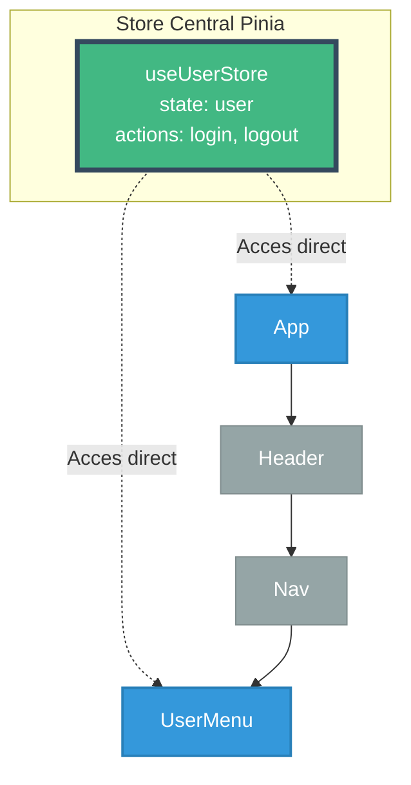
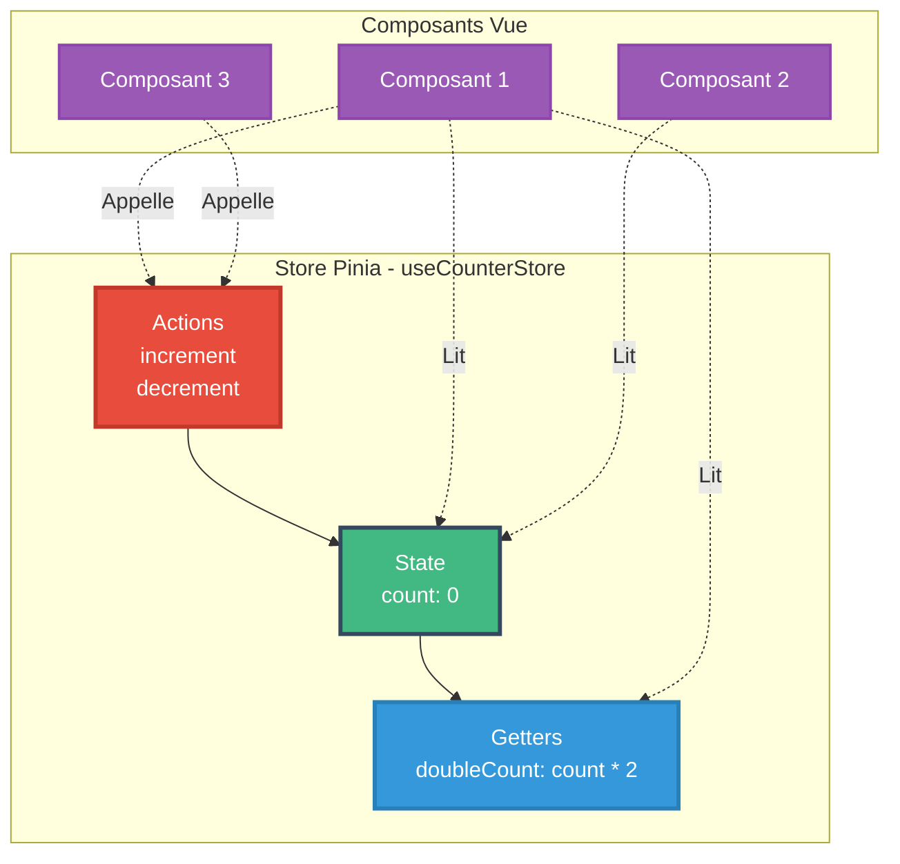

# Module 4
## State Management avec Pinia

---


# Qu'est-ce que le State Management ?

Le **State Management** est la gestion centralisée de l'état de l'application

### 🏦 Analogie : C'est comme une banque centrale

Sans State Management, c'est comme si **chaque personne gardait son argent chez soi** :
- Difficile de savoir qui a combien 💰
- Impossible de faire des transferts facilement
- Chaos total si quelqu'un veut vérifier le total !

Avec State Management, **une banque centrale** :
- Tout l'argent au même endroit 🏦
- Transactions faciles et traçables
- Vue d'ensemble claire

---

# Le problème : Props Drilling

### 😱 Le cauchemar du Props Drilling

```mermaid
graph TB
    A[App<br/>user: { nom, email }]
    H[Header<br/>Ne fait que passer user]
    N[Nav<br/>Ne fait que passer user]
    UM[UserMenu<br/>Utilise ENFIN user!]
    
    A -->|:user='user'| H
    H -->|:user='user'| N
    N -->|:user='user'| UM
    
    style A fill:#42b883,stroke:#35495e,stroke-width:3px,color:#fff
    style H fill:#e67e22,stroke:#d35400,stroke-width:2px,color:#fff
    style N fill:#e67e22,stroke:#d35400,stroke-width:2px,color:#fff
    style UM fill:#3498db,stroke:#2980b9,stroke-width:3px,color:#fff
```

**3 composants intermédiaires** qui ne font que passer la donnée ! C'est lourd...

---

# La solution : Pinia !

### ✨ Solution avec Pinia



**Chaque composant prend ce dont il a besoin, directement à la source !**

### 🆚 Comparaison

- **Redux (React)** : Beaucoup de boilerplate, complexe
- **Context API (React)** : Simple mais performances limitées
- **Pinia (Vue)** : Simple ET performant ! Le meilleur des deux mondes 🎉

---

# Pourquoi Pinia ?

**Pinia** est le gestionnaire d'état officiel pour Vue.js 3

### Avantages de Pinia (2025)

- 🎯 Simple et intuitif
- ⚡ Léger (~ 1kb)
- 🔧 Support TypeScript natif
- 🛠️ DevTools intégrés
- 🌳 Tree-shaking automatique
- 🧩 Modular par design
- ✅ Composition API first

---

# Pinia vs Vuex

| Caractéristique | Pinia | Vuex |
|-----------------|-------|------|
| **Complexité** | Simple | Plus complexe |
| **Mutations** | Non (directement les actions) | Oui |
| **TypeScript** | Excellent | Moyen |
| **DevTools** | Excellents | Bons |
| **Modules** | Natif | Configuration nécessaire |
| **Statut** | Officiellement recommandé | Legacy |

---

# Installation de Pinia

```bash
npm install pinia
```

---

# Configuration dans main.js

```javascript
// main.js
import { createApp } from 'vue';
import { createPinia } from 'pinia';
import App from './App.vue';

const app = createApp(App);
const pinia = createPinia();

app.use(pinia);
app.mount('#app');
```

---

# Créer un Store simple



```javascript
// stores/counter.js
import { defineStore } from 'pinia';
import { ref, computed } from 'vue';

export const useCounterStore = defineStore('counter', () => {
  // State
  const count = ref(0);
  
  // Getters
  const doubleCount = computed(() => count.value * 2);
  
  // Actions
  const increment = () => {
    count.value++;
  };
  
  const decrement = () => {
    count.value--;
  };
  
  return {
    count,
    doubleCount,
    increment,
    decrement
  };
});
```

---

# Utiliser le Store avec Options API

```vue
<script>
import { useCounterStore } from '@/stores/counter';

export default {
  computed: {
    counter() {
      return useCounterStore();
    },
    count() {
      return this.counter.count;
    },
    doubleCount() {
      return this.counter.doubleCount;
    }
  }
}
</script>

<template>
  <div>
    <p>Count: {{ count }}</p>
    <p>Double: {{ doubleCount }}</p>
    
    <button @click="counter.increment">+</button>
    <button @click="counter.decrement">-</button>
  </div>
</template>
```

---

# Store avec Options API syntax

```javascript
// stores/user.js
import { defineStore } from 'pinia';

export const useUserStore = defineStore('user', {
  state: () => ({
    nom: '',
    email: '',
    isLoggedIn: false
  }),
  
  getters: {
    displayName: (state) => {
      return state.nom.toUpperCase();
    }
  },
  
  actions: {
    login(nom, email) {
      this.nom = nom;
      this.email = email;
      this.isLoggedIn = true;
    },
    
    logout() {
      this.nom = '';
      this.email = '';
      this.isLoggedIn = false;
    }
  }
});
```

---

# State - Données réactives

Le state contient les données réactives du store - **Syntaxe Options recommandée**

```javascript
import { defineStore } from 'pinia';

export const useProductStore = defineStore('products', {
  state: () => ({
    // State simple
    loading: false,
    error: null,
    
    // State tableau
    products: [],
    
    // State objet
    filters: {
      search: '',
      category: '',
      minPrice: 0,
    maxPrice: 1000
  });
  
  return { loading, error, products, filters };
});
```

---

# Getters - Propriétés calculées

Les getters sont des propriétés calculées basées sur le state

### 🧮 Analogie : Les getters sont comme une calculatrice

Imaginez une boutique :
- **State** : `products` (liste brute des produits)
- **Getter** : `totalPrice` (calcule automatiquement le total)

Vous ne stockez PAS le total, vous le **calculez à la demande** !

### 💡 Pourquoi des getters ?

**Sans getter** : vous devez calculer partout
```javascript
// Dans ComponentA
const total = products.reduce((sum, p) => sum + p.prix, 0);

// Dans ComponentB
const total = products.reduce((sum, p) => sum + p.prix, 0); // Duplication !
```

**Avec getter** : calculé une fois, utilisé partout
```javascript
const total = store.totalPrice; // Simple et réutilisable !
```

---

# Getters vs Redux selectors

### 🆚 En Redux : ce sont les selectors (mais plus verbeux)

```javascript
export const useProductStore = defineStore('products', () => {
  const products = ref([]);
  const filters = reactive({ search: '', category: '' });
  
  // Getter simple
  const productCount = computed(() => products.value.length);
  
  // Getter filtré
  const filteredProducts = computed(() => {
    return products.value.filter(p => {
      const matchSearch = p.nom.toLowerCase()
        .includes(filters.search.toLowerCase());
      const matchCategory = !filters.category || 
                           p.category === filters.category;
      return matchSearch && matchCategory;
    });
  });
  
  // Getter avec calcul
  const totalValue = computed(() => {
    return products.value.reduce((sum, p) => sum + p.prix, 0);
  });
  
  return { products, filters, productCount, filteredProducts, totalValue };
});
```

---

# Getters avec paramètres

```javascript
export const useProductStore = defineStore('products', () => {
  const products = ref([]);
  
  // Getter qui retourne une fonction
  const getProductById = computed(() => {
    return (id) => products.value.find(p => p.id === id);
  });
  
  const getProductsByCategory = computed(() => {
    return (category) => {
      return products.value.filter(p => p.category === category);
    };
  });
  
  return { products, getProductById, getProductsByCategory };
});
```

---

# Utilisation des getters

```vue
<script>
import { useProductStore } from '@/stores/products';

export default {
  computed: {
    store() {
      return useProductStore();
    },
    product() {
      return this.store.getProductById(42);
    },
    electronics() {
      return this.store.getProductsByCategory('electronics');
    }
  }
}
</script>

<template>
  <div>
    <p>Total: {{ store.productCount }} produits</p>
    <p>Valeur totale: {{ store.totalValue }}€</p>
    
    <div v-for="product in store.filteredProducts" :key="product.id">
      {{ product.nom }}
    </div>
  </div>
</template>
```

---

# Actions - Méthodes

Les actions modifient le state

```javascript
export const useProductStore = defineStore('products', () => {
  const products = ref([]);
  const loading = ref(false);
  const error = ref(null);
  
  const fetchProducts = async () => {
    loading.value = true;
    error.value = null;
    
    try {
      const response = await fetch('/api/products');
      const data = await response.json();
      products.value = data;
    } catch (e) {
      error.value = e.message;
    } finally {
      loading.value = false;
    }
  };
  
  const addProduct = (product) => {
    products.value.push({
      ...product,
      id: Date.now()
    });
  };
  
  return { products, loading, error, fetchProducts, addProduct };
});
```

---

# Actions avec mutation directe

Pinia permet la mutation directe du state (contrairement à Vuex)

```javascript
export const useCartStore = defineStore('cart', () => {
  const items = ref([]);
  
  const addToCart = (product) => {
    const existingItem = items.value.find(i => i.id === product.id);
    
    if (existingItem) {
      // Mutation directe
      existingItem.quantity++;
    } else {
      items.value.push({
        ...product,
        quantity: 1
      });
    }
  };
  
  const removeFromCart = (productId) => {
    const index = items.value.findIndex(i => i.id === productId);
    if (index > -1) {
      items.value.splice(index, 1);
    }
  };
  
  const clearCart = () => {
    items.value = [];
  };
  
  return { items, addToCart, removeFromCart, clearCart };
});
```

---

# Store avec données API

```javascript
// stores/users.js
import { defineStore } from 'pinia';
import { ref } from 'vue';

export const useUsersStore = defineStore('users', () => {
  const users = ref([]);
  const loading = ref(false);
  const error = ref(null);
  
  const fetchUsers = async () => {
    loading.value = true;
    try {
      const res = await fetch('https://jsonplaceholder.typicode.com/users');
      users.value = await res.json();
    } catch (e) {
      error.value = e.message;
    } finally {
      loading.value = false;
    }
  };
  
  const getUserById = (id) => {
    return users.value.find(u => u.id === id);
  };
  
  const createUser = async (userData) => {
    try {
      const res = await fetch('https://jsonplaceholder.typicode.com/users', {
        method: 'POST',
        headers: { 'Content-Type': 'application/json' },
        body: JSON.stringify(userData)
      });
      const newUser = await res.json();
      users.value.push(newUser);
      return newUser;
    } catch (e) {
      error.value = e.message;
      throw e;
    }
  };
  
  return { users, loading, error, fetchUsers, getUserById, createUser };
});
```

---

# Utilisation dans un composant

```vue
<script>
import { useUsersStore } from '@/stores/users';

export default {
  computed: {
    usersStore() {
      return useUsersStore();
    }
  },
  methods: {
    async handleCreateUser() {
      try {
        await this.usersStore.createUser({
          nom: 'Alice',
          email: 'alice@example.com'
        });
      } catch (error) {
        console.error('Erreur:', error);
      }
    }
  },
  mounted() {
    this.usersStore.fetchUsers();
  }
}
</script>

<template>
  <div>
    <div v-if="usersStore.loading">Chargement...</div>
    <div v-else-if="usersStore.error">Erreur: {{ usersStore.error }}</div>
    <div v-else>
      <div v-for="user in usersStore.users" :key="user.id">
        {{ user.name }}
      </div>
    </div>
    
    <button @click="handleCreateUser">Créer</button>
  </div>
</template>
```

---

# Accès au store avec Options API

```vue
<script>
import { useUserStore } from '@/stores/user';

export default {
  computed: {
    userStore() {
      return useUserStore();
    },
    nom() {
      return this.userStore.nom;
    },
    email() {
      return this.userStore.email;
    },
    isLoggedIn() {
      return this.userStore.isLoggedIn;
    }
  },
  methods: {
    logout() {
      this.userStore.logout();
    }
  }
}
</script>

<template>
  <div>
    <p v-if="isLoggedIn">Bonjour {{ nom }}</p>
    <button @click="logout">Déconnexion</button>
  </div>
</template>
```

---

# Multiples stores

```javascript
// stores/auth.js
export const useAuthStore = defineStore('auth', () => {
  const token = ref('');
  const user = ref(null);
  
  return { token, user };
});

// stores/cart.js
export const useCartStore = defineStore('cart', () => {
  const items = ref([]);
  
  return { items };
});

// stores/products.js
export const useProductsStore = defineStore('products', () => {
  const products = ref([]);
  
  return { products };
});
```

---

# Utiliser plusieurs stores ensemble

```vue
<script>
import { useAuthStore } from '@/stores/auth';
import { useCartStore } from '@/stores/cart';
import { useProductsStore } from '@/stores/products';

export default {
  computed: {
    auth() {
      return useAuthStore();
    },
    cart() {
      return useCartStore();
    },
    products() {
      return useProductsStore();
    }
  },
  methods: {
    addToCart(product) {
      if (this.auth.user) {
        this.cart.addToCart(product);
      } else {
        alert('Veuillez vous connecter');
      }
    }
  }
}
</script>
```

---

# Communication entre stores

```javascript
// stores/cart.js
import { useAuthStore } from './auth';
import { useProductsStore } from './products';

export const useCartStore = defineStore('cart', () => {
  const items = ref([]);
  
  const addToCart = (productId) => {
    const authStore = useAuthStore();
    const productsStore = useProductsStore();
    
    if (!authStore.isLoggedIn) {
      throw new Error('Non connecté');
    }
    
    const product = productsStore.getProductById(productId);
    if (product) {
      items.value.push(product);
    }
  };
  
  return { items, addToCart };
});
```

---

# Persistence avec localStorage

```javascript
// stores/cart.js
import { defineStore } from 'pinia';
import { ref, watch } from 'vue';

export const useCartStore = defineStore('cart', () => {
  // Charger depuis localStorage
  const savedCart = localStorage.getItem('cart');
  const items = ref(savedCart ? JSON.parse(savedCart) : []);
  
  // Sauvegarder à chaque changement
  watch(items, (newItems) => {
    localStorage.setItem('cart', JSON.stringify(newItems));
  }, { deep: true });
  
  const addToCart = (product) => {
    items.value.push(product);
  };
  
  const clearCart = () => {
    items.value = [];
  };
  
  return { items, addToCart, clearCart };
});
```

---

# Plugin Pinia pour persistence

```javascript
// plugins/piniaPlugins.js
export function piniaPersistedState() {
  return ({ store }) => {
    // Charger depuis localStorage au démarrage
    const saved = localStorage.getItem(store.$id);
    if (saved) {
      store.$patch(JSON.parse(saved));
    }
    
    // Sauvegarder à chaque changement
    store.$subscribe((mutation, state) => {
      localStorage.setItem(store.$id, JSON.stringify(state));
    });
  };
}

// main.js
import { createPinia } from 'pinia';
import { piniaPersistedState } from './plugins/piniaPlugins';

const pinia = createPinia();
pinia.use(piniaPersistedState());
```

---

# Reset du store

```javascript
export const useUserStore = defineStore('user', () => {
  const nom = ref('');
  const email = ref('');
  const isLoggedIn = ref(false);
  
  const initialState = {
    nom: '',
    email: '',
    isLoggedIn: false
  };
  
  const $reset = () => {
    nom.value = initialState.nom;
    email.value = initialState.email;
    isLoggedIn.value = initialState.isLoggedIn;
  };
  
  return { nom, email, isLoggedIn, $reset };
});
```

---

# $patch - Mise à jour groupée

```vue
<script>
import { useUserStore } from '@/stores/user';

export default {
  methods: {
    updateUser() {
      const userStore = useUserStore();
      
      // Mise à jour individuelle (multiple réactivités)
      userStore.nom = 'Alice';
      userStore.email = 'alice@example.com';
      userStore.age = 25;
      
      // ✅ Mise à jour groupée (une seule réactivité)
      userStore.$patch({
        nom: 'Alice',
        email: 'alice@example.com',
        age: 25
      });
      
      // Ou avec fonction
      userStore.$patch((state) => {
        state.nom = 'Alice';
        state.email = 'alice@example.com';
        state.age = 25;
      });
    }
  }
}
</script>
```

---

# DevTools Vue

Pinia s'intègre parfaitement aux Vue DevTools

### Fonctionnalités

- 🔍 Inspection du state
- 📊 Timeline des actions
- ⏮️ Time-travel debugging
- 💾 Export/Import du state
- 🎯 Édition du state en direct

---

# TypeScript avec Pinia

```typescript
// stores/products.ts
import { defineStore } from 'pinia';
import { ref, computed } from 'vue';

interface Product {
  id: number;
  nom: string;
  prix: number;
  stock: number;
}

export const useProductsStore = defineStore('products', () => {
  const products = ref<Product[]>([]);
  const loading = ref<boolean>(false);
  
  const totalValue = computed((): number => {
    return products.value.reduce((sum, p) => sum + p.prix, 0);
  });
  
  const addProduct = (product: Product): void => {
    products.value.push(product);
  };
  
  return { products, loading, totalValue, addProduct };
});
```

---

# Résumé du Module 4

✅ **Concepts** : State Management, avantages de Pinia

✅ **Installation** : Configuration dans l'application

✅ **Store** : Création avec Composition API et Options API

✅ **State** : Données réactives centralisées

✅ **Getters** : Propriétés calculées, getters avec paramètres

✅ **Actions** : Méthodes, appels API, mutations

✅ **Avancé** : Multiple stores, persistence, DevTools, TypeScript

---

# Travaux pratiques - Module 4

### Exercices à réaliser

1. 🏪 **Store Products** : Gestion de produits (CRUD complet)
2. 🛒 **Store Cart** : Panier d'achat avec calculs
3. 👤 **Store Auth** : Authentification et permissions
4. 💾 **Persistence** : localStorage pour le panier
5. 🔗 **Multiple stores** : Interaction entre auth, cart, products
6. 📊 **Store avec API** : Fetch data et gestion d'erreurs

### Projet fil rouge

Intégrer Pinia dans l'application de produits
