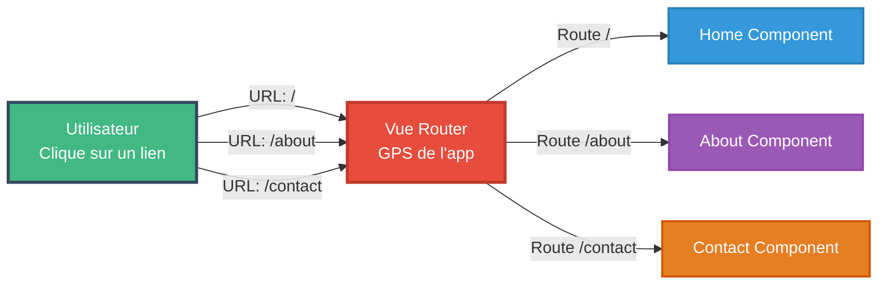
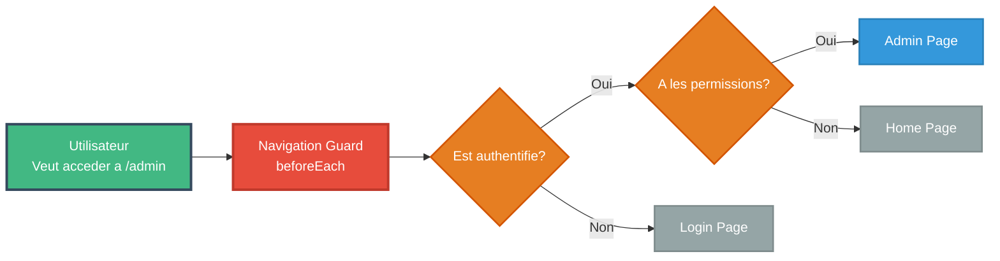

<a name="module5-router" id="module5-router"></a>

# Module 4
## Navigation et routage avec Vue Router

---

# SOMMAIRE DU MODULE

<div class="flex flex-col gap-2">
<Link to="router-intro">🗺️ 5.1 Introduction à Vue Router</Link>
<Link to="router-config">⚙️ 5.2 Configuration et routes</Link>
<Link to="router-advanced">🚀 5.3 Fonctionnalités avancées</Link>
</div>

<br>

<Link to="module5-exercices">💪 Exercices Pratiques du Module 5</Link>

---
layout: new-section
routeAlias: "router-intro"
---

<a name="router-intro" id="router-intro"></a>

# 5.1 Introduction à Vue Router

---

# Qu'est-ce que Vue Router ?

**Vue Router** est le routeur officiel pour les applications Vue.js

### 🗺️ Analogie : Vue Router est comme un GPS

Imaginez votre application comme une ville :
- **Les routes** = les rues de la ville 🏘️
- **Le Router** = votre GPS 📱
- **Les composants** = les destinations (maison, bureau, magasin...)

Quand vous tapez une adresse (URL), le GPS (Router) vous emmène à la bonne destination (composant) !

### 🆚 Sans Router : SPA = Single Page (vraiment UNE page)

**Application traditionnelle multi-pages** :

<small>

```
/index.html      ← Page 1 (rechargement complet ⏳)
/about.html      ← Page 2 (rechargement complet ⏳)
/contact.html    ← Page 3 (rechargement complet ⏳)
```

</small>

---

# Schéma : Vue Router - Navigation



---

# SPA avec Vue Router

**SPA avec Router** :

<small>

```
/                ← Home Component (instantané ⚡)
/about           ← About Component (instantané ⚡)
/contact         ← Contact Component (instantané ⚡)
```

</small>

---

# La magie du SPA

Une seule page HTML, mais l'illusion de plusieurs pages !

### Fonctionnalités

<small>

- 🛤️ **Navigation entre "pages"** : sans rechargement complet !
- 📍 **Gestion de l'URL** : /products/123 au lieu de ?page=products&id=123
- 🔙 **Historique** : boutons retour/avant fonctionnent
- 🔐 **Guards** : "Tu ne passeras pas !" sans authentification
- ⚡ **Lazy loading** : charger les pages à la demande
- 🎯 **Routes dynamiques** : /user/:id pour tous les utilisateurs

</small>

---
layout: new-section
routeAlias: "router-config"
---

<a name="router-config" id="router-config"></a>

# 5.2 Configuration et routes

---

# Installation

```bash
npm install vue-router@4
```

---

# Configuration de base

```javascript
// router/index.js
import { createRouter, createWebHistory } from 'vue-router';
import Home from '../views/Home.vue';
import About from '../views/About.vue';

const routes = [
  {
    path: '/',
    name: 'home',
    component: Home
  },
  {
    path: '/about',
    name: 'about',
    component: About
  }
];

const router = createRouter({
  history: createWebHistory(),
  routes
});

export default router;
```

---

# Intégration dans main.js

```javascript
// main.js
import { createApp } from 'vue';
import App from './App.vue';
import router from './router';

const app = createApp(App);

app.use(router);
app.mount('#app');
```

---

# RouterView et RouterLink

```vue
<!-- App.vue -->
<template>
  <div>
    <nav>
      <RouterLink to="/">Accueil</RouterLink>
      <RouterLink to="/about">À propos</RouterLink>
      <RouterLink to="/contact">Contact</RouterLink>
    </nav>
    
    <main>
      <RouterView />
    </main>
  </div>
</template>
```

---

# Routes dynamiques

```javascript
const routes = [
  {
    path: '/user/:id',
    name: 'user',
    component: UserProfile
  },
  {
    path: '/product/:slug',
    name: 'product',
    component: ProductDetail
  }
];
```

---

# Accéder aux paramètres de route

```vue
<script>
export default {
  computed: {
    userId() {
      return this.$route.params.id;
    },
    tab() {
      return this.$route.query.tab;
    }
  }
}
</script>

<template>
  <div>
    <h1>User ID: {{ $route.params.id }}</h1>
    <p>Tab: {{ $route.query.tab }}</p>
  </div>
</template>
```

---

# Navigation programmatique

```vue
<script>
export default {
  methods: {
    goToUser(id) {
      this.$router.push(`/user/${id}`);
    },
    goBack() {
      this.$router.back();
    },
    goToAbout() {
      this.$router.push({ name: 'about' });
    },
    goToProduct() {
      this.$router.push({
        name: 'product',
        params: { slug: 'laptop' },
        query: { color: 'black' }
      });
    }
  }
}
</script>
```

---

# Lazy Loading des routes

```javascript
const routes = [
  {
    path: '/',
    name: 'home',
    component: () => import('../views/Home.vue')
  },
  {
    path: '/about',
    name: 'about',
    component: () => import('../views/About.vue')
  },
  {
    path: '/admin',
    name: 'admin',
    component: () => import('../views/Admin.vue')
  }
];
```

---

---
layout: new-section
routeAlias: "router-advanced"
---

<a name="router-advanced" id="router-advanced"></a>

# 5.3 Fonctionnalités avancées

---

# Routes imbriquées (Nested Routes)

```javascript
const routes = [
  {
    path: '/user/:id',
    component: UserLayout,
    children: [
      {
        path: '',
        name: 'user-profile',
        component: UserProfile
      },
      {
        path: 'posts',
        name: 'user-posts',
        component: UserPosts
      },
      {
        path: 'settings',
        name: 'user-settings',
        component: UserSettings
      }
    ]
  }
];
```

---

# Component avec routes imbriquées

```vue
<!-- UserLayout.vue -->
<template>
  <div class="user-layout">
    <aside>
      <RouterLink :to="`/user/${userId}`">Profil</RouterLink>
      <RouterLink :to="`/user/${userId}/posts`">Posts</RouterLink>
      <RouterLink :to="`/user/${userId}/settings`">Paramètres</RouterLink>
    </aside>
    
    <main>
      <RouterView />
    </main>
  </div>
</template>
```

---

# Named Views (avancé)

Pour des layouts complexes avec plusieurs RouterView nommées

```javascript
// Configuration
const routes = [{
  path: '/',
  components: {
    default: Home,
    sidebar: Sidebar,
    footer: Footer
  }
}];
```

```vue
<!-- Utilisation -->
<template>
  <RouterView name="sidebar" />
  <RouterView /> <!-- default -->
  <RouterView name="footer" />
</template>
```

---

# Guards de navigation - beforeEach

### 🚦 Les Guards sont comme des feux de circulation

Imaginez un **videur de boîte de nuit** :
- Il vérifie votre carte d'identité 🪪
- Si vous avez l'âge requis → **next()** (vous entrez ✅)
- Sinon → **next('/home')** (vous dégagez ❌)

### 🛡️ Types de guards

**beforeEach** : Garde global (vérifie TOUT le monde)
**beforeEnter** : Garde spécifique (juste pour une route)
**beforeRouteEnter** : Garde dans le composant

### 💡 Cas d'usage typiques

- 🔐 **Authentification** : "Es-tu connecté ?"
- 👮 **Autorisation** : "As-tu le droit d'être admin ?"
- 💾 **Sauvegarde** : "As-tu sauvegardé tes modifications ?"
- 📊 **Analytics** : Tracker les visites de pages

---

# Schéma : Navigation Guards



---

# Exemple de Guard

```javascript
router.beforeEach((to, from, next) => {
  const isAuthenticated = checkAuth();
  
  // Si la route nécessite l'auth ET que l'user n'est pas connecté
  if (to.meta.requiresAuth && !isAuthenticated) {
    next('/login'); // ❌ Redirection vers login
  } else {
    next(); // ✅ Passe ton chemin, tu es bon !
  }
});
```

---

# Guards par route

```javascript
const routes = [
  {
    path: '/admin',
    component: Admin,
    beforeEnter: (to, from) => {
      if (!isAdmin()) {
        return false;
      }
    }
  }
];
```

---

# 🎯 Exercice TaskFlow : Navigation Guards

Protégeons TaskFlow avec des **guards d'authentification** !

### 📝 Objectif

Empêcher l'accès aux routes protégées sans connexion

---

# 🎯 TaskFlow Router - Configuration (1/2)

### Créer router/index.js

<small>

```javascript
import { createRouter, createWebHistory } from 'vue-router';
import { useAuthStore } from '../stores/auth';

const routes = [
  {
    path: '/',
    name: 'Home',
    component: () => import('../views/HomeView.vue'),
    meta: { title: 'Accueil - TaskFlow' }
  },
  {
    path: '/tasks',
    name: 'Tasks',
    component: () => import('../views/TaskListView.vue'),
    meta: { 
      requiresAuth: true,
      title: 'Mes tâches - TaskFlow'
    }
  },
  {
    path: '/task/:id',
    name: 'TaskDetail',
    component: () => import('../views/TaskDetailView.vue'),
    meta: { requiresAuth: true }
  },
```

</small>

---

# 🎯 TaskFlow Router - Configuration (2/2)

<small>

```javascript
  {
    path: '/dashboard',
    name: 'Dashboard',
    component: () => import('../views/DashboardView.vue'),
    meta: { 
      requiresAuth: true,
      requiresAdmin: true,
      title: 'Dashboard - TaskFlow'
    }
  },
  {
    path: '/login',
    name: 'Login',
    component: () => import('../views/LoginView.vue'),
    meta: { title: 'Connexion - TaskFlow' }
  },
  {
    path: '/:pathMatch(.*)*',
    name: 'NotFound',
    component: () => import('../views/NotFoundView.vue')
  }
];

const router = createRouter({
  history: createWebHistory(),
  routes
});
```

</small>

---

# 🎯 TaskFlow Router - Guards

### Guard global beforeEach

<small>

```javascript
router.beforeEach((to, from, next) => {
  const authStore = useAuthStore();
  
  // 1. Changer le titre de la page
  document.title = to.meta.title || 'TaskFlow';
  
  // 2. Vérifier l'authentification
  if (to.meta.requiresAuth && !authStore.isAuthenticated) {
    next({
      name: 'Login',
      query: { redirect: to.fullPath }
    });
    return;
  }
  
  // 3. Vérifier les droits admin
  if (to.meta.requiresAdmin && !authStore.canCreateCategories) {
    alert('Accès réservé aux administrateurs');
    next({ name: 'Home' });
    return;
  }
  
  next();
});

export default router;
```

</small>

### 💡 N'oubliez pas

Créer `useAuthStore()` dans Module 4 avec `isAuthenticated` et `canCreateCategories` !

### ✅ Correction

👉 `taskflow-app/src/router/index.js`

---

# 🎯 Exercice TaskFlow : TaskListView.vue

Créons la vue principale qui affiche la liste des tâches !

### 📝 Objectif

Une vue complète qui utilise le **store Pinia** et le **router**

---

#### 🎯 TaskListView - Spécifications

<small>

```vue
<script>
import { useTasksStore } from '@/stores/tasks';
import { useCategoriesStore } from '@/stores/categories';
import TaskList from '@/components/TaskList.vue';
import TaskForm from '@/components/TaskForm.vue';

export default {
  name: 'TaskListView',
  components: {
    TaskList,
    TaskForm
  },
  computed: {
    tasksStore() {
      return useTasksStore();
    },
    categoriesStore() {
      return useCategoriesStore();
    }
  },
  methods: {
    handleAddTask(taskData) {
      this.tasksStore.addTask(taskData);
    },
    handleToggleTask(id) {
      this.tasksStore.toggleTask(id);
    },
    handleDeleteTask(id) {
      this.tasksStore.deleteTask(id);
    },
    goToTaskDetail(id) {
      this.$router.push({ name: 'TaskDetail', params: { id } });
    }
  },
  mounted() {
    this.tasksStore.loadFromStorage();
  }
}
</script>

<template>
  <div class="task-list-view">
    <h1>Mes Tâches</h1>
    
    <TaskForm @add-task="handleAddTask" />
    
    <TaskList
      :tasks="tasksStore.tasks"
      @toggle="handleToggleTask"
      @delete="handleDeleteTask"
      @task-click="goToTaskDetail"
    />
  </div>
</template>
```


### ✅ Correction

👉 `taskflow-app/src/views/TaskListView.vue`

</small>

---

# 🎯 Exercice TaskFlow : TaskDetailView.vue

Créons la vue de détail qui utilise les **params dynamiques** !

### 📝 Objectif

Afficher et éditer une tâche spécifique via son ID dans l'URL

---

#### 🎯 TaskDetailView - Spécifications

<small>

```vue
<script>
import { useTasksStore } from '@/stores/tasks';

export default {
  name: 'TaskDetailView',
  data() {
    return {
      task: null,
      isEditing: false
    }
  },
  computed: {
    tasksStore() {
      return useTasksStore();
    },
    taskId() {
      return parseInt(this.$route.params.id);
    }
  },
  methods: {
    loadTask() {
      this.task = this.tasksStore.getTaskById(this.taskId);
      if (!this.task) {
        this.$router.push({ name: 'NotFound' });
      }
    },
    saveTask() {
      this.tasksStore.updateTask(this.taskId, this.task);
      this.isEditing = false;
    },
    goBack() {
      this.$router.back();
    }
  },
  mounted() {
    this.loadTask();
  },
  beforeRouteUpdate(to, from) {
    // Recharger si on change d'ID dans l'URL
    if (to.params.id !== from.params.id) {
      this.loadTask();
    }
  }
}
</script>

<template>
  <div v-if="task" class="task-detail">
    <button @click="goBack">← Retour</button>
    
    <h1>{{ task.title }}</h1>
    
    <div v-if="!isEditing">
      <p>{{ task.description }}</p>
      <p>Priorité: {{ task.priority }}</p>
      <button @click="isEditing = true">Éditer</button>
    </div>
    
    <form v-else @submit.prevent="saveTask">
      <input v-model="task.title" required />
      <textarea v-model="task.description"></textarea>
      <button type="submit">Sauvegarder</button>
      <button type="button" @click="isEditing = false">Annuler</button>
    </form>
  </div>
</template>
```


### ✅ Correction

👉 `taskflow-app/src/views/TaskDetailView.vue`

</small>

---

# 🎯 Exercice TaskFlow : LoginView.vue

Créons la vue de connexion avec **redirection** !

### 📝 Objectif

Formulaire de connexion qui redirige vers la page d'origine après login

---

#### 🎯 LoginView - Spécifications

<small>

```vue
<script>
import { useAuthStore } from '@/stores/auth';

export default {
  name: 'LoginView',
  data() {
    return {
      credentials: {
        email: '',
        password: ''
      },
      error: null
    }
  },
  computed: {
    authStore() {
      return useAuthStore();
    },
    redirectPath() {
      return this.$route.query.redirect || '/tasks';
    }
  },
  methods: {
    async handleLogin() {
      try {
        this.error = null;
        await this.authStore.login(this.credentials);
        
        // Redirection vers la page d'origine ou /tasks
        this.$router.push(this.redirectPath);
      } catch (err) {
        this.error = 'Identifiants incorrects';
      }
    }
  }
}
</script>

<template>
  <div class="login-view">
    <h1>Connexion</h1>
    
    <form @submit.prevent="handleLogin">
      <div>
        <label>Email</label>
        <input
          v-model="credentials.email"
          type="email"
          required
          placeholder="votre@email.com"
        />
      </div>
      
      <div>
        <label>Mot de passe</label>
        <input
          v-model="credentials.password"
          type="password"
          required
          placeholder="••••••••"
        />
      </div>
      
      <p v-if="error" class="error">{{ error }}</p>
      
      <button type="submit">Se connecter</button>
    </form>
  </div>
</template>
```

</small>

---

# 💡 Astuce

<small>

Le `query.redirect` est défini par le guard `beforeEach` dans le router !

### ✅ Correction

👉 `taskflow-app/src/views/LoginView.vue`

</small>

---

# 🎯 Exercice TaskFlow : NotFoundView.vue

Créons la page 404 pour les routes invalides !

### 📝 Objectif

Une page d'erreur élégante avec redirection vers l'accueil

---

#### 🎯 NotFoundView - Spécifications

<small>

```vue
<script>
export default {
  name: 'NotFoundView',
  methods: {
    goHome() {
      this.$router.push('/');
    }
  }
}
</script>

<template>
  <div class="not-found">
    <h1>404</h1>
    <h2>Page non trouvée</h2>
    <p>La page que vous recherchez n'existe pas.</p>
    
    <button @click="goHome">Retour à l'accueil</button>
    
    <p class="url-info">
      URL demandée : <code>{{ $route.fullPath }}</code>
    </p>
  </div>
</template>

<style scoped>
.not-found {
  text-align: center;
  padding: 4rem 2rem;
}

.not-found h1 {
  font-size: 8rem;
  font-weight: bold;
  color: #ef4444;
}

.url-info {
  margin-top: 2rem;
  color: #64748b;
  font-size: 0.875rem;
}

code {
  background: #f1f5f9;
  padding: 0.25rem 0.5rem;
  border-radius: 0.25rem;
  font-family: monospace;
}
</style>
```


#### 💡 Route à ajouter

N'oubliez pas d'ajouter la route catch-all dans `router/index.js` :

</small>

---

<small>

```js
{
  path: '/:pathMatch(.*)*',
  name: 'NotFound',
  component: () => import('../views/NotFoundView.vue')
}
```

</small>

### ✅ Correction

👉 `taskflow-app/src/views/NotFoundView.vue`

---

# Guards dans le composant

```vue
<script>
export default {
  methods: {
    async fetchUser(id) {
      // Logique de récupération utilisateur
    }
  },
  beforeRouteLeave(to, from) {
    const answer = window.confirm(
      'Voulez-vous vraiment quitter ? Les modifications non sauvegardées seront perdues.'
    );
    
    if (!answer) return false;
  },
  async beforeRouteUpdate(to, from) {
    if (to.params.id !== from.params.id) {
      await this.fetchUser(to.params.id);
    }
  }
}
</script>
```

---

# Redirections

```javascript
const routes = [
  {
    path: '/home',
    redirect: '/'
  },
  {
    path: '/old-path',
    redirect: { name: 'new-route' }
  },
  {
    path: '/search/:searchText',
    redirect: to => {
      return { path: '/search', query: { q: to.params.searchText } };
    }
  }
];
```

---

# Route 404

```javascript
const routes = [
  // ... autres routes
  {
    path: '/:pathMatch(.*)*',
    name: 'not-found',
    component: NotFound
  }
];
```

---

# Meta fields

```javascript
const routes = [
  {
    path: '/admin',
    component: Admin,
    meta: {
      requiresAuth: true,
      roles: ['admin'],
      title: 'Administration'
    }
  }
];

router.beforeEach((to) => {
  document.title = to.meta.title || 'Mon App';
});
```

---

# Mode history vs hash

```javascript
import { createRouter, createWebHistory, createWebHashHistory } from 'vue-router';

// Mode History (recommandé)
// URL: https://example.com/user/123
const router = createRouter({
  history: createWebHistory(),
  routes
});

// Mode Hash
// URL: https://example.com/#/user/123
const router = createRouter({
  history: createWebHashHistory(),
  routes
});
```

---

# Résumé Module 5

- ✅ Installation et configuration Vue Router
- ✅ Routes basiques et dynamiques
- ✅ Navigation programmatique
- ✅ Lazy loading
- ✅ Routes imbriquées
- ✅ Guards de navigation
- ✅ Redirections et 404
- ✅ Meta fields
- ✅ Modes history et hash

---

# 🎯 Bonus TaskFlow : HomePage.vue

Créons une page d'accueil élégante !

```vue
<template>
  <div class="home-page">
    <div class="hero">
      <h1>📋 Bienvenue sur TaskFlow</h1>
      <p>Gérez vos tâches efficacement avec Vue.js 3</p>
      
      <div class="hero-actions">
        <RouterLink to="/tasks" class="btn-primary">
          Voir mes tâches
        </RouterLink>
        <RouterLink to="/login" class="btn-secondary">
          Se connecter
        </RouterLink>
      </div>
    </div>
    
    <div class="features">
      <div class="feature-card">
        <div class="feature-icon">✅</div>
        <h3>Gestion simple</h3>
        <p>Créez, modifiez et supprimez vos tâches facilement</p>
      </div>
      <!-- + 2 autres feature cards -->
    </div>
  </div>
</template>
```

✅ `taskflow-app/src/views/HomePage.vue`

---

# Travaux pratiques

Vous avez maintenant TOUS les éléments pour reproduire TaskFlow :

✅ **Components** : TaskItem, TaskForm, TaskList, TaskCard, BoardColumn, TaskModal  
✅ **Stores** : tasks, auth, categories  
✅ **Router** : Guards, routes dynamiques, lazy loading  
✅ **Vues** : TaskListView, TaskDetailView, LoginView, NotFoundView, HomePage

### 🎯 Application complète disponible

👉 Voir `taskflow-app/` pour la correction complète
