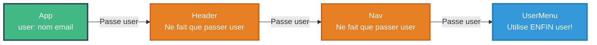
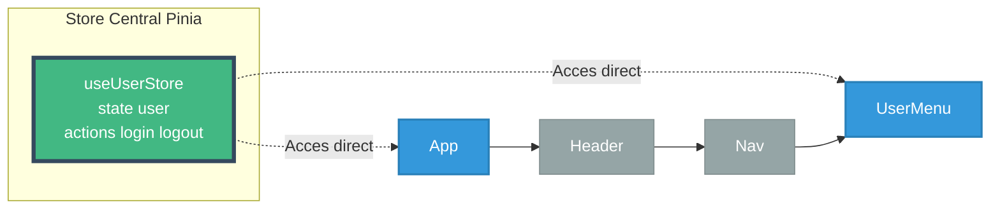
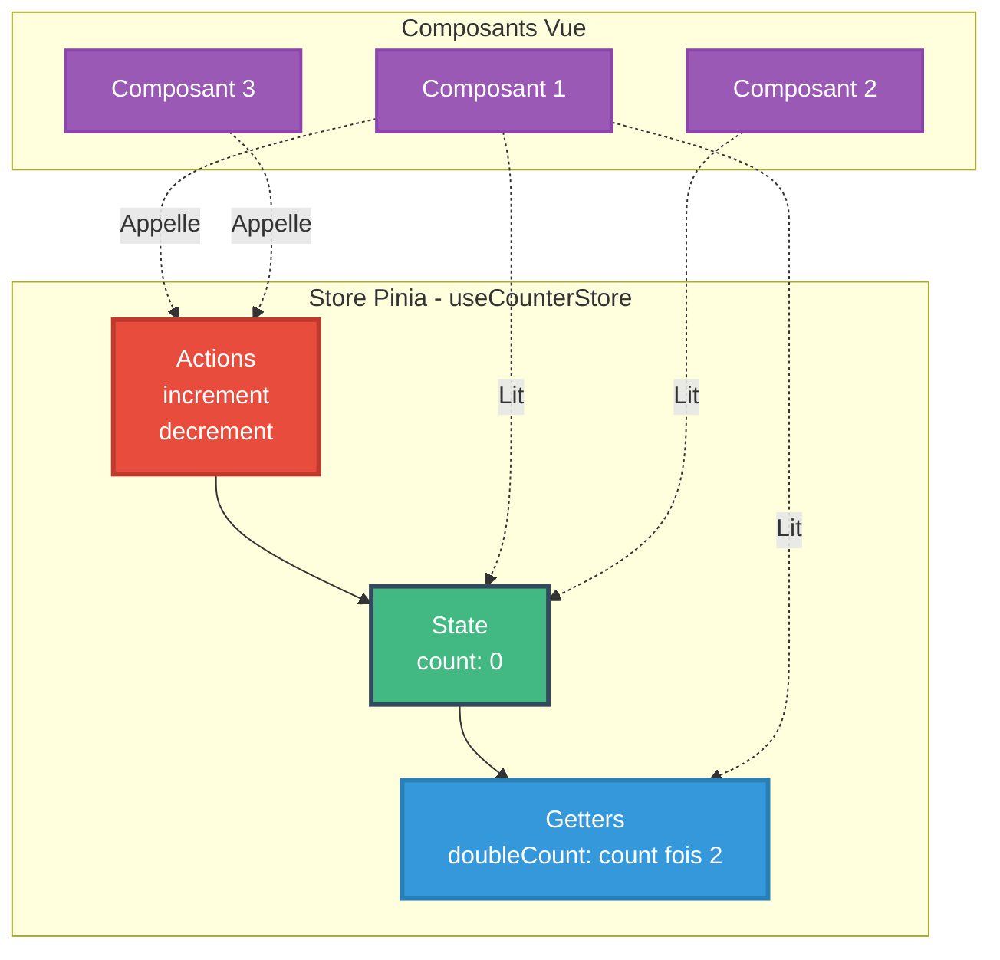

<a name="module4-pinia" id="module4-pinia"></a>

# Module 5
## State Management avec Pinia

---

# SOMMAIRE DU MODULE

<div class="flex flex-col gap-2">
<Link to="state-management-intro">🏦 4.1 Introduction au State Management</Link>
<Link to="pinia-basics">🍍 4.2 Bases de Pinia</Link>
<Link to="pinia-advanced">🚀 4.3 Pinia avancé</Link>
</div>

<br>

<Link to="module4-exercices">💪 Exercices Pratiques du Module 4</Link>

---
layout: new-section
routeAlias: "state-management-intro"
---

<a name="state-management-intro" id="state-management-intro"></a>

# 4.1 Introduction au State Management

---

# Qu'est-ce que le State Management ?

Le **State Management** est la gestion centralisée de l'état de l'application

### 🏦 Analogie : C'est comme une banque centrale

Sans State Management, c'est comme si **chaque personne gardait son argent chez soi** :
- Difficile de savoir qui a combien 💰
- Impossible de faire des transferts facilement
- Chaos total si quelqu'un veut vérifier le total !

Avec State Management, **une banque centrale** :
- Tout l'argent au même endroit 🏦
- Transactions faciles et traçables
- Vue d'ensemble claire

---

# Le problème : Props Drilling

### 😱 Le cauchemar du Props Drilling

**3 composants intermédiaires** qui ne font que passer la donnée ! C'est lourd...

```
App (user)
  └── Header (user) ← Passe user
       └── Nav (user) ← Passe user
            └── UserMenu (user) ← Utilise ENFIN user !
```

---

# Schéma : Props Drilling



---

# La solution : Pinia !

### ✨ Solution avec Pinia

```
App → utilise useUserStore()
Header → n'a pas besoin de user
Nav → n'a pas besoin de user
UserMenu → utilise useUserStore() ← Accès direct !
```

**Chaque composant prend ce dont il a besoin, directement à la source !**

---

# Schéma : Solution avec Pinia



---

# Pourquoi Pinia ?

**Pinia** est le gestionnaire d'état officiel pour Vue.js 3

### Avantages de Pinia (2025)

<small>

- 🎯 Simple et intuitif
- ⚡ Léger (~ 1kb)
- 🔧 Support TypeScript natif
- 🛠️ DevTools intégrés
- 🌳 Tree-shaking automatique
- 🧩 Modular par design
- ✅ Composition API first

</small>

---

---
layout: new-section
routeAlias: "pinia-basics"
---

<a name="pinia-basics" id="pinia-basics"></a>

# 4.2 Bases de Pinia

---

# Installation de Pinia

```bash
npm install pinia
```

---

# Configuration dans main.js

```javascript
// main.js
import { createApp } from 'vue';
import { createPinia } from 'pinia';
import App from './App.vue';

const app = createApp(App);
const pinia = createPinia();

app.use(pinia);
app.mount('#app');
```

---

# Créer un Store simple

```javascript
// stores/counter.js
import { defineStore } from 'pinia';

export const useCounterStore = defineStore('counter', {
  // State
  state: () => ({
    count: 0
  }),
  
  // Getters
  getters: {
    doubleCount: (state) => state.count * 2
  },
  
  // Actions
  actions: {
    increment() {
      this.count++;
    },
    decrement() {
      this.count--;
    }
  }
});
```

---

#### Schéma : Architecture d'un Store Pinia



---

# Utiliser le Store avec Options API

```vue
<script>
import { useCounterStore } from '@/stores/counter';

export default {
  computed: {
    counter() {
      return useCounterStore();
    },
    count() {
      return this.counter.count;
    },
    doubleCount() {
      return this.counter.doubleCount;
    }
  }
}
</script>

<template>
  <div>
    <p>Count: {{ count }}</p>
    <p>Double: {{ doubleCount }}</p>
    
    <button @click="counter.increment">+</button>
    <button @click="counter.decrement">-</button>
  </div>
</template>
```

---

# Store avec Options API syntax

```javascript
// stores/user.js
import { defineStore } from 'pinia';

export const useUserStore = defineStore('user', {
  state: () => ({
    nom: '',
    email: '',
    isLoggedIn: false
  }),
  
  getters: {
    displayName: (state) => {
      return state.nom.toUpperCase();
    }
  },
  
  actions: {
    login(nom, email) {
      this.nom = nom;
      this.email = email;
      this.isLoggedIn = true;
    },
    
    logout() {
      this.nom = '';
      this.email = '';
      this.isLoggedIn = false;
    }
  }
});
```

---

# State - Données réactives

Le state contient les données réactives du store - **Syntaxe Options recommandée**

```javascript
import { defineStore } from 'pinia';

export const useProductStore = defineStore('products', {
  state: () => ({
    // State simple
    loading: false,
    error: null,
    
    // State tableau
    products: [],
    
    // State objet
    filters: {
      search: '',
      category: '',
      minPrice: 0,
    maxPrice: 1000
  });
  
  return { loading, error, products, filters };
});
```

---

# Getters - Propriétés calculées

Les getters sont des propriétés calculées basées sur le state

### 🧮 Analogie : Les getters sont comme une calculatrice

Imaginez une boutique :
- **State** : `products` (liste brute des produits)
- **Getter** : `totalPrice` (calcule automatiquement le total)

Vous ne stockez PAS le total, vous le **calculez à la demande** !

### 💡 Pourquoi des getters ?

**Sans getter** : vous devez calculer partout
```javascript
// Dans ComponentA
const total = products.reduce((sum, p) => sum + p.prix, 0);

// Dans ComponentB
const total = products.reduce((sum, p) => sum + p.prix, 0); // Duplication !
```

**Avec getter** : calculé une fois, utilisé partout
```javascript
const total = store.totalPrice; // Simple et réutilisable !
```

---

# Getters vs Redux selectors

### 🆚 Options API : la syntaxe recommandée pour cette formation

```javascript
export const useProductStore = defineStore('products', {
  state: () => ({
    products: [],
    filters: {
      search: '',
      category: ''
    }
  }),
  
  getters: {
    // Getter simple
    productCount: (state) => state.products.length,
    
    // Getter filtré
    filteredProducts: (state) => {
      return state.products.filter(p => {
        const matchSearch = p.nom.toLowerCase()
          .includes(state.filters.search.toLowerCase());
        const matchCategory = !state.filters.category || 
                             p.category === state.filters.category;
        return matchSearch && matchCategory;
      });
    },
    
    // Getter avec calcul
    totalValue: (state) => {
      return state.products.reduce((sum, p) => sum + p.prix, 0);
    }
  }
});
```

---

# Getters avec paramètres

```javascript
export const useProductStore = defineStore('products', {
  state: () => ({
    products: []
  }),
  
  getters: {
    // Getter qui retourne une fonction
    getProductById: (state) => {
      return (id) => state.products.find(p => p.id === id);
    },
    
    getProductsByCategory: (state) => {
      return (category) => {
        return state.products.filter(p => p.category === category);
      };
    }
  }
});
```

---

# Utilisation des getters

```vue
<script>
import { useProductStore } from '@/stores/products';

export default {
  computed: {
    store() {
      return useProductStore();
    },
    product() {
      return this.store.getProductById(42);
    },
    electronics() {
      return this.store.getProductsByCategory('electronics');
    }
  }
}
</script>

<template>
  <div>
    <p>Total: {{ store.productCount }} produits</p>
    <p>Valeur totale: {{ store.totalValue }}€</p>
    
    <div v-for="product in store.filteredProducts" :key="product.id">
      {{ product.nom }}
    </div>
  </div>
</template>
```

---

# Actions - Méthodes

Les actions modifient le state

```javascript
export const useProductStore = defineStore('products', {
  state: () => ({
    products: [],
    loading: false,
    error: null
  }),
  
  actions: {
    async fetchProducts() {
      this.loading = true;
      this.error = null;
      
      try {
        const response = await fetch('/api/products');
        const data = await response.json();
        this.products = data;
      } catch (e) {
        this.error = e.message;
      } finally {
        this.loading = false;
      }
    },
    
    addProduct(product) {
      this.products.push({
        ...product,
        id: Date.now()
      });
    }
  }
});
```

---

# Actions avec mutation directe

Pinia permet la mutation directe du state

<small>

```javascript
export const useCartStore = defineStore('cart', {
  state: () => ({
    items: []
  }),
  
  actions: {
    addToCart(product) {
      const existingItem = this.items.find(i => i.id === product.id);
      
      if (existingItem) {
        // Mutation directe
        existingItem.quantity++;
      } else {
        this.items.push({
          ...product,
          quantity: 1
        });
      }
    },
    
    removeFromCart(productId) {
      const index = this.items.findIndex(i => i.id === productId);
      if (index > -1) {
        this.items.splice(index, 1);
      }
    },
    
    clearCart() {
      this.items = [];
    }
  }
});
```

</small>

---

# Store avec données API

<small>

```javascript
// stores/users.js
import { defineStore } from 'pinia';

export const useUsersStore = defineStore('users', {
  state: () => ({
    users: [],
    loading: false,
    error: null
  }),
  
  actions: {
    async fetchUsers() {
      this.loading = true;
      try {
        const res = await fetch('https://jsonplaceholder.typicode.com/users');
        this.users = await res.json();
      } catch (e) {
        this.error = e.message;
      } finally {
        this.loading = false;
      }
    },
    
    getUserById(id) {
      return this.users.find(u => u.id === id);
    },
    
    async createUser(userData) {
      try {
        const res = await fetch('https://jsonplaceholder.typicode.com/users', {
          method: 'POST',
          headers: { 'Content-Type': 'application/json' },
          body: JSON.stringify(userData)
        });
        const newUser = await res.json();
        this.users.push(newUser);
        return newUser;
      } catch (e) {
        this.error = e.message;
        throw e;
      }
    }
  }
});
```

</small>

---

# Utilisation dans un composant

<small>

```vue
<script>
import { useUsersStore } from '@/stores/users';

export default {
  computed: {
    usersStore() {
      return useUsersStore();
    }
  },
  methods: {
    async handleCreateUser() {
      try {
        await this.usersStore.createUser({
          nom: 'Alice',
          email: 'alice@example.com'
        });
      } catch (error) {
        console.error('Erreur:', error);
      }
    }
  },
  mounted() {
    this.usersStore.fetchUsers();
  }
}
</script>

<template>
  <div>
    <div v-if="usersStore.loading">Chargement...</div>
    <div v-else-if="usersStore.error">Erreur: {{ usersStore.error }}</div>
    <div v-else>
      <div v-for="user in usersStore.users" :key="user.id">
        {{ user.name }}
      </div>
    </div>
    
    <button @click="handleCreateUser">Créer</button>
  </div>
</template>
```

</small>

---

# Accès au store avec Options API

```vue
<script>
import { useUserStore } from '@/stores/user';

export default {
  computed: {
    userStore() {
      return useUserStore();
    },
    nom() {
      return this.userStore.nom;
    },
    email() {
      return this.userStore.email;
    },
    isLoggedIn() {
      return this.userStore.isLoggedIn;
    }
  },
  methods: {
    logout() {
      this.userStore.logout();
    }
  }
}
</script>

<template>
  <div>
    <p v-if="isLoggedIn">Bonjour {{ nom }}</p>
    <button @click="logout">Déconnexion</button>
  </div>
</template>
```

---

---
layout: new-section
routeAlias: "pinia-advanced"
---

<a name="pinia-advanced" id="pinia-advanced"></a>

# 4.3 Pinia avancé

---

# Multiples stores

```javascript
// stores/auth.js
export const useAuthStore = defineStore('auth', {
  state: () => ({
    token: '',
    user: null
  })
});

// stores/cart.js
export const useCartStore = defineStore('cart', {
  state: () => ({
    items: []
  })
});

// stores/products.js
export const useProductsStore = defineStore('products', {
  state: () => ({
    products: []
  })
});
```

---

# Utiliser plusieurs stores ensemble

```vue
<script>
import { useAuthStore } from '@/stores/auth';
import { useCartStore } from '@/stores/cart';
import { useProductsStore } from '@/stores/products';

export default {
  computed: {
    auth() {
      return useAuthStore();
    },
    cart() {
      return useCartStore();
    },
    products() {
      return useProductsStore();
    }
  },
  methods: {
    addToCart(product) {
      if (this.auth.user) {
        this.cart.addToCart(product);
      } else {
        alert('Veuillez vous connecter');
      }
    }
  }
}
</script>
```

---

# Communication entre stores

<small>

```javascript
// stores/cart.js
import { useAuthStore } from './auth';
import { useProductsStore } from './products';

export const useCartStore = defineStore('cart', {
  state: () => ({
    items: []
  }),
  
  actions: {
    addToCart(productId) {
      const authStore = useAuthStore();
      const productsStore = useProductsStore();
      
      if (!authStore.isLoggedIn) {
        throw new Error('Non connecté');
      }
      
      const product = productsStore.getProductById(productId);
      if (product) {
        this.items.push(product);
      }
    }
  }
});
```

</small>

---

# Persistence avec localStorage

```javascript
// stores/cart.js
import { defineStore } from 'pinia';
import { ref, watch } from 'vue';

export const useCartStore = defineStore('cart', () => {
  // Charger depuis localStorage
  const savedCart = localStorage.getItem('cart');
  const items = ref(savedCart ? JSON.parse(savedCart) : []);
  
  // Sauvegarder à chaque changement
  watch(items, (newItems) => {
    localStorage.setItem('cart', JSON.stringify(newItems));
  }, { deep: true });
  
  const addToCart = (product) => {
    items.value.push(product);
  };
  
  const clearCart = () => {
    items.value = [];
  };
  
  return { items, addToCart, clearCart };
});
```

---

# DevTools Vue

Pinia s'intègre parfaitement aux Vue DevTools

### Fonctionnalités

<small>

- 🔍 Inspection du state
- 📊 Timeline des actions
- ⏮️ Time-travel debugging
- 💾 Export/Import du state
- 🎯 Édition du state en direct

</small>

---

# TypeScript avec Pinia

```typescript
// stores/products.ts
import { defineStore } from 'pinia';
import { ref, computed } from 'vue';

interface Product {
  id: number;
  nom: string;
  prix: number;
  stock: number;
}

export const useProductsStore = defineStore('products', () => {
  const products = ref<Product[]>([]);
  const loading = ref<boolean>(false);
  
  const totalValue = computed((): number => {
    return products.value.reduce((sum, p) => sum + p.prix, 0);
  });
  
  const addProduct = (product: Product): void => {
    products.value.push(product);
  };
  
  return { products, loading, totalValue, addProduct };
});
```

---

# Résumé du Module 4

✅ **Concepts** : State Management, avantages de Pinia

✅ **Installation** : Configuration dans l'application

✅ **Store** : Création avec Composition API et Options API

✅ **State** : Données réactives centralisées

✅ **Getters** : Propriétés calculées, getters avec paramètres

✅ **Actions** : Méthodes, appels API, mutations

✅ **Avancé** : Multiple stores, persistence, DevTools, TypeScript

---
layout: new-section
---

# 🎯 Exercices Fil Rouge TaskFlow
## Module 4

Créons les stores Pinia de TaskFlow !

---

# 🎯 Exercice 1 : useTasksStore()

Créez le store principal pour gérer les tâches

### State

- `tasks` (Array) : Tâches avec données par défaut
- `filter` : 'all' | 'active' | 'done'
- `loading`, `error`

### Getters

- `filteredTasks` : Retourne les tâches selon le filtre
- `activeCount`, `doneCount` : Compteurs
- `getTaskById(id)` : Getter paramétré

### Actions

- `addTask`, `updateTask`, `deleteTask`, `toggleTask`
- `setFilter`, `clearCompleted`
- `_persist()`, `loadFromStorage()` : Persistence localStorage

### 💡 Correction

👉 **Module 4 - Exercices** OU `taskflow-app/src/stores/tasks.js`

---

# 🎯 Exercice 2 : useCategoriesStore()

Créez le store pour gérer les catégories

### State

- `categories` (Array) : `[{ id, name, color }]`

### Actions

- `addCategory`, `deleteCategory`
- **Communication inter-stores** : Utiliser `useTasksStore()` pour supprimer les tâches de la catégorie supprimée

### 💡 Correction

👉 **Module 4 - Exercices** OU `taskflow-app/src/stores/categories.js`

---

# 🎯 Exercice 3 : useAuthStore()

Créez le store d'authentification

### State

- `user`, `token`, `isAuthenticated`

### Getters

- `userDisplayName` : Prénom + Nom
- `canDeleteTasks` : Vérifie le rôle (admin ou editor)
- `canCreateCategories` : Vérifie le rôle admin

### Actions

- `login(credentials)` : Mock ou API
- `logout()` : Nettoyer user + token + localStorage
- `checkAuth()` : Vérifier le token au démarrage

### 💡 Utilisation Module 5

Ce store sera utilisé dans les navigation guards !

### 💡 Correction

👉 **Module 4 - Exercices** OU `taskflow-app/src/stores/auth.js`

---

# Travaux pratiques - Module 4

### Exercices à réaliser

1. 🏪 **Store Products** : Gestion de produits (CRUD complet)
2. 🛒 **Store Cart** : Panier d'achat avec calculs
3. 👤 **Store Auth** : Authentification et permissions
4. 💾 **Persistence** : localStorage pour le panier
5. 🔗 **Multiple stores** : Interaction entre auth, cart, products
6. 📊 **Store avec API** : Fetch data et gestion d'erreurs

### Projet fil rouge

Intégrer Pinia dans l'application de produits
