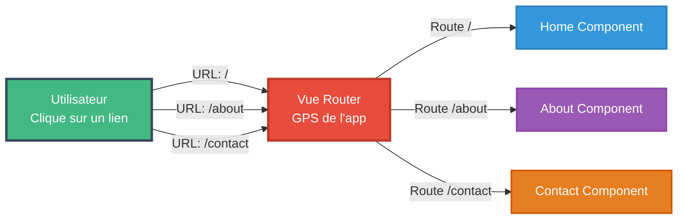
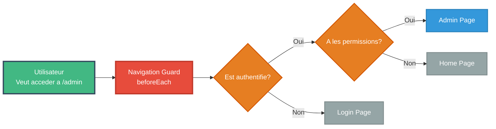

# Module 5
## Navigation et routage avec Vue Router

---

# SOMMAIRE DU MODULE

<div class="flex flex-col gap-2">
<Link to="router-intro">🗺️ 5.1 Introduction à Vue Router</Link>
<Link to="router-config">⚙️ 5.2 Configuration et routes</Link>
<Link to="router-advanced">🚀 5.3 Fonctionnalités avancées</Link>
</div>

---
layout: new-section
routeAlias: "router-intro"
---

<a name="router-intro" id="router-intro"></a>

# 5.1 Introduction à Vue Router

---

# Qu'est-ce que Vue Router ?

**Vue Router** est le routeur officiel pour les applications Vue.js

### 🗺️ Analogie : Vue Router est comme un GPS

Imaginez votre application comme une ville :
- **Les routes** = les rues de la ville 🏘️
- **Le Router** = votre GPS 📱
- **Les composants** = les destinations (maison, bureau, magasin...)

Quand vous tapez une adresse (URL), le GPS (Router) vous emmène à la bonne destination (composant) !

### 🆚 Sans Router : SPA = Single Page (vraiment UNE page)

**Application traditionnelle multi-pages** :
```
/index.html      ← Page 1 (rechargement complet ⏳)
/about.html      ← Page 2 (rechargement complet ⏳)
/contact.html    ← Page 3 (rechargement complet ⏳)
```

---

# Schéma : Vue Router - Navigation



---

# SPA avec Vue Router

**SPA avec Router** :
```
/                ← Home Component (instantané ⚡)
/about           ← About Component (instantané ⚡)
/contact         ← Contact Component (instantané ⚡)
```

---

# La magie du SPA

Une seule page HTML, mais l'illusion de plusieurs pages !

### Fonctionnalités

- 🛤️ **Navigation entre "pages"** : sans rechargement complet !
- 📍 **Gestion de l'URL** : /products/123 au lieu de ?page=products&id=123
- 🔙 **Historique** : boutons retour/avant fonctionnent
- 🔐 **Guards** : "Tu ne passeras pas !" sans authentification
- ⚡ **Lazy loading** : charger les pages à la demande
- 🎯 **Routes dynamiques** : /user/:id pour tous les utilisateurs

---

---
layout: new-section
routeAlias: "router-config"
---

<a name="router-config" id="router-config"></a>

# 5.2 Configuration et routes

---

# Installation

```bash
npm install vue-router@4
```

---

# Configuration de base

```javascript
// router/index.js
import { createRouter, createWebHistory } from 'vue-router';
import Home from '../views/Home.vue';
import About from '../views/About.vue';

const routes = [
  {
    path: '/',
    name: 'home',
    component: Home
  },
  {
    path: '/about',
    name: 'about',
    component: About
  }
];

const router = createRouter({
  history: createWebHistory(),
  routes
});

export default router;
```

---

# Intégration dans main.js

```javascript
// main.js
import { createApp } from 'vue';
import App from './App.vue';
import router from './router';

const app = createApp(App);

app.use(router);
app.mount('#app');
```

---

# RouterView et RouterLink

```vue
<!-- App.vue -->
<template>
  <div>
    <nav>
      <RouterLink to="/">Accueil</RouterLink>
      <RouterLink to="/about">À propos</RouterLink>
      <RouterLink to="/contact">Contact</RouterLink>
    </nav>
    
    <main>
      <RouterView />
    </main>
  </div>
</template>
```

---

# Routes dynamiques

```javascript
const routes = [
  {
    path: '/user/:id',
    name: 'user',
    component: UserProfile
  },
  {
    path: '/product/:slug',
    name: 'product',
    component: ProductDetail
  }
];
```

---

# Accéder aux paramètres de route

```vue
<script>
export default {
  computed: {
    userId() {
      return this.$route.params.id;
    },
    tab() {
      return this.$route.query.tab;
    }
  }
}
</script>

<template>
  <div>
    <h1>User ID: {{ $route.params.id }}</h1>
    <p>Tab: {{ $route.query.tab }}</p>
  </div>
</template>
```

---

# Navigation programmatique

```vue
<script>
export default {
  methods: {
    goToUser(id) {
      this.$router.push(`/user/${id}`);
    },
    goBack() {
      this.$router.back();
    },
    goToAbout() {
      this.$router.push({ name: 'about' });
    },
    goToProduct() {
      this.$router.push({
        name: 'product',
        params: { slug: 'laptop' },
        query: { color: 'black' }
      });
    }
  }
}
</script>
```

---

# Lazy Loading des routes

```javascript
const routes = [
  {
    path: '/',
    name: 'home',
    component: () => import('../views/Home.vue')
  },
  {
    path: '/about',
    name: 'about',
    component: () => import('../views/About.vue')
  },
  {
    path: '/admin',
    name: 'admin',
    component: () => import('../views/Admin.vue')
  }
];
```

---

---
layout: new-section
routeAlias: "router-advanced"
---

<a name="router-advanced" id="router-advanced"></a>

# 5.3 Fonctionnalités avancées

---

# Routes imbriquées (Nested Routes)

```javascript
const routes = [
  {
    path: '/user/:id',
    component: UserLayout,
    children: [
      {
        path: '',
        name: 'user-profile',
        component: UserProfile
      },
      {
        path: 'posts',
        name: 'user-posts',
        component: UserPosts
      },
      {
        path: 'settings',
        name: 'user-settings',
        component: UserSettings
      }
    ]
  }
];
```

---

# Component avec routes imbriquées

```vue
<!-- UserLayout.vue -->
<template>
  <div class="user-layout">
    <aside>
      <RouterLink :to="`/user/${userId}`">Profil</RouterLink>
      <RouterLink :to="`/user/${userId}/posts`">Posts</RouterLink>
      <RouterLink :to="`/user/${userId}/settings`">Paramètres</RouterLink>
    </aside>
    
    <main>
      <RouterView />
    </main>
  </div>
</template>
```

---

# Named Views

Plusieurs RouterView dans la même route

```javascript
const routes = [
  {
    path: '/',
    components: {
      default: Home,
      sidebar: Sidebar,
      footer: Footer
    }
  }
];
```

---

# Utilisation des Named Views

```vue
<template>
  <div>
    <RouterView name="sidebar" />
    <RouterView />
    <RouterView name="footer" />
  </div>
</template>
```

---

# Guards de navigation - beforeEach

### 🚦 Les Guards sont comme des feux de circulation

Imaginez un **videur de boîte de nuit** :
- Il vérifie votre carte d'identité 🪪
- Si vous avez l'âge requis → **next()** (vous entrez ✅)
- Sinon → **next('/home')** (vous dégagez ❌)

### 🛡️ Types de guards

**beforeEach** : Garde global (vérifie TOUT le monde)
**beforeEnter** : Garde spécifique (juste pour une route)
**beforeRouteEnter** : Garde dans le composant

### 💡 Cas d'usage typiques

- 🔐 **Authentification** : "Es-tu connecté ?"
- 👮 **Autorisation** : "As-tu le droit d'être admin ?"
- 💾 **Sauvegarde** : "As-tu sauvegardé tes modifications ?"
- 📊 **Analytics** : Tracker les visites de pages

---

# Schéma : Navigation Guards



---

# Exemple de Guard

```javascript
router.beforeEach((to, from, next) => {
  const isAuthenticated = checkAuth();
  
  // Si la route nécessite l'auth ET que l'user n'est pas connecté
  if (to.meta.requiresAuth && !isAuthenticated) {
    next('/login'); // ❌ Redirection vers login
  } else {
    next(); // ✅ Passe ton chemin, tu es bon !
  }
});
```

---

# Guards par route

```javascript
const routes = [
  {
    path: '/admin',
    component: Admin,
    beforeEnter: (to, from) => {
      if (!isAdmin()) {
        return false;
      }
    }
  }
];
```

---

# Guards dans le composant

```vue
<script>
export default {
  methods: {
    async fetchUser(id) {
      // Logique de récupération utilisateur
    }
  },
  beforeRouteLeave(to, from) {
    const answer = window.confirm(
      'Voulez-vous vraiment quitter ? Les modifications non sauvegardées seront perdues.'
    );
    
    if (!answer) return false;
  },
  async beforeRouteUpdate(to, from) {
    if (to.params.id !== from.params.id) {
      await this.fetchUser(to.params.id);
    }
  }
}
</script>
```

---

# Redirections

```javascript
const routes = [
  {
    path: '/home',
    redirect: '/'
  },
  {
    path: '/old-path',
    redirect: { name: 'new-route' }
  },
  {
    path: '/search/:searchText',
    redirect: to => {
      return { path: '/search', query: { q: to.params.searchText } };
    }
  }
];
```

---

# Route 404

```javascript
const routes = [
  // ... autres routes
  {
    path: '/:pathMatch(.*)*',
    name: 'not-found',
    component: NotFound
  }
];
```

---

# Meta fields

```javascript
const routes = [
  {
    path: '/admin',
    component: Admin,
    meta: {
      requiresAuth: true,
      roles: ['admin'],
      title: 'Administration'
    }
  }
];

router.beforeEach((to) => {
  document.title = to.meta.title || 'Mon App';
});
```

---

# Mode history vs hash

```javascript
import { createRouter, createWebHistory, createWebHashHistory } from 'vue-router';

// Mode History (recommandé)
// URL: https://example.com/user/123
const router = createRouter({
  history: createWebHistory(),
  routes
});

// Mode Hash
// URL: https://example.com/#/user/123
const router = createRouter({
  history: createWebHashHistory(),
  routes
});
```

---

# Transitions entre routes

```vue
<template>
  <RouterView v-slot="{ Component }">
    <Transition name="fade" mode="out-in">
      <component :is="Component" />
    </Transition>
  </RouterView>
</template>

<style>
.fade-enter-active,
.fade-leave-active {
  transition: opacity 0.3s;
}

.fade-enter-from,
.fade-leave-to {
  opacity: 0;
}
</style>
```

---

# Scroll Behavior

```javascript
const router = createRouter({
  history: createWebHistory(),
  routes,
  scrollBehavior(to, from, savedPosition) {
    if (savedPosition) {
      return savedPosition;
    }
    if (to.hash) {
      return { el: to.hash };
    }
    return { top: 0 };
  }
});
```

---

# Résumé Module 5

✅ Installation et configuration Vue Router

✅ Routes basiques et dynamiques

✅ Navigation programmatique

✅ Lazy loading

✅ Routes imbriquées

✅ Guards de navigation

✅ Redirections et 404

✅ Meta fields

✅ Modes history et hash

---

# Travaux pratiques

1. 🛤️ Créer un système de routing complet
2. 🔐 Implémenter des guards d'authentification
3. ⚡ Lazy loading des pages
4. 🎯 Routes dynamiques pour les produits
5. 🏗️ Routes imbriquées pour le dashboard
6. 🚫 Page 404 personnalisée

### Projet fil rouge

Ajouter le routing à l'application de produits
