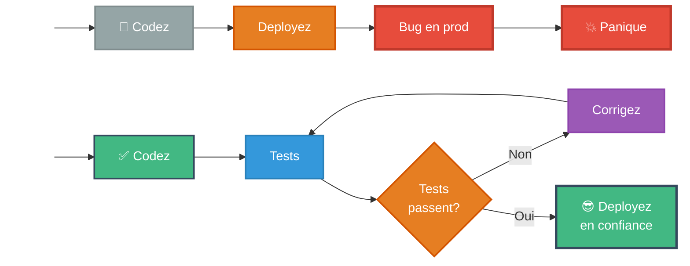
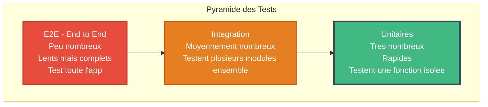

<a name="module6-tests" id="module6-tests"></a>

# Module 6
## Tests sous Vue.js avec Vitest

---

# SOMMAIRE DU MODULE

<div class="flex flex-col gap-2">
<Link to="tests-intro">🧪 6.1 Pourquoi tester ?</Link>
<Link to="vitest-setup">⚙️ 6.2 Configuration Vitest</Link>
<Link to="tests-composants">🧩 6.3 Tester des composants</Link>
<Link to="tests-integration">🔗 6.4 Tests d'intégration</Link>
</div>

<br>

<Link to="module6-exercices">💪 Exercices Pratiques du Module 6</Link>

---
layout: new-section
routeAlias: "tests-intro"
---

<a name="tests-intro" id="tests-intro"></a>

# 6.1 Pourquoi tester ?

---

# Pourquoi tester son code ?

### 🤔 "Les tests c'est pour les faibles !"

**FAUX !** Les tests sont pour les **pros** qui veulent dormir tranquilles la nuit ! 😴

### 🏥 Analogie : Les tests sont comme des examens médicaux

Vous faites des analyses de sang **AVANT** d'être malade, pas après !

**Sans tests** :
```
Vous codez → Déployez → 💥 Bug en production → 😱 Panique
```

**Avec tests** :
```
Vous codez → Tests échouent → Vous corrigez → Tests passent ✅ → 😎 Déploiement serein
```

---

#### Schéma : Avec vs Sans tests



---

# Le coût d'un bug

### 💰 Le coût réel d'un bug

- **Développement** : 1€ (facile à corriger)
- **En production** : 100€ (clients mécontents, rollback urgent...)
- **Bug critique en prod** : 10 000€ (perte de clients, réputation...)

### Avantages des tests

<small>

- ✅ **Détection précoce des bugs** : trouvez-les AVANT vos utilisateurs
- 🔒 **Confiance lors des refactorings** : changez du code sans peur
- 📝 **Documentation vivante** : les tests montrent comment utiliser votre code
- 🚀 **Maintenance facile** : comprenez le code 6 mois après
- 👥 **Collaboration** : vos collègues vous remercieront
- ⚡ **Plus rapide au final** : moins de temps en debug

</small>

### 🎯 La règle d'or

"Le code non testé est un code cassé par défaut" - Quelqu'un de sage, probablement

---

# Types de tests

### Pyramide des tests

**Plus on descend, plus il y a de tests !**

- **Tests E2E** (End-to-End) : Peu nombreux, lents mais complets
- **Tests d'intégration** : Moyennement nombreux
- **Tests unitaires** : Très nombreux, rapides

---

# Schéma : Pyramide des tests



---
layout: new-section
routeAlias: "vitest-setup"
---

<a name="vitest-setup" id="vitest-setup"></a>

# 6.2 Configuration Vitest

---

# Vitest - Le test runner moderne

**Vitest** est le framework de test recommandé pour Vue.js 3 en 2025

### Avantages de Vitest

<small>

- ⚡ Ultra-rapide (compatible Vite)
- 🔧 Configuration minimale
- 🎯 Compatible Jest API
- 📊 Coverage intégré
- 🔥 Hot Module Replacement
- 🌐 Support ESM natif
- ⚙️ Watch mode intelligent

</small>

---

# Installation

```bash
npm install -D vitest @vue/test-utils jsdom
```

---

# Configuration vite.config.js

```javascript
// vite.config.js
import { defineConfig } from 'vite';
import vue from '@vitejs/plugin-vue';

export default defineConfig({
  plugins: [vue()],
  test: {
    environment: 'jsdom',
    globals: true
  }
});
```

---

# Script dans package.json

```json
{
  "scripts": {
    "dev": "vite",
    "build": "vite build",
    "test": "vitest",
    "test:ui": "vitest --ui",
    "test:coverage": "vitest --coverage"
  }
}
```

---

# Premier test simple

```javascript
// sum.test.js
import { describe, it, expect } from 'vitest';

function sum(a, b) {
  return a + b;
}

describe('sum function', () => {
  it('should add two numbers', () => {
    expect(sum(1, 2)).toBe(3);
  });
  
  it('should handle negative numbers', () => {
    expect(sum(-1, -2)).toBe(-3);
  });
});
```

---

# Tester un composable

```javascript
// composables/useCounter.js
import { ref } from 'vue';

export function useCounter(initial = 0) {
  const count = ref(initial);
  
  const increment = () => count.value++;
  const decrement = () => count.value--;
  const reset = () => count.value = initial;
  
  return { count, increment, decrement, reset };
}
```

---

# Test du composable

```javascript
// composables/useCounter.test.js
import { describe, it, expect } from 'vitest';
import { useCounter } from './useCounter';

describe('useCounter', () => {
  it('should initialize with default value', () => {
    const { count } = useCounter();
    expect(count.value).toBe(0);
  });
  
  it('should initialize with custom value', () => {
    const { count } = useCounter(10);
    expect(count.value).toBe(10);
  });
  
  it('should increment', () => {
    const { count, increment } = useCounter();
    increment();
    expect(count.value).toBe(1);
  });
  
  it('should reset to initial value', () => {
    const { count, increment, reset } = useCounter(5);
    increment();
    increment();
    reset();
    expect(count.value).toBe(5);
  });
});
```

---
layout: new-section
routeAlias: "tests-composants"
---

<a name="tests-composants" id="tests-composants"></a>

# 6.3 Tester des composants

---

# Tester un composant Vue

```javascript
// components/Counter.test.js
import { describe, it, expect } from 'vitest';
import { mount } from '@vue/test-utils';
import Counter from './Counter.vue';

describe('Counter Component', () => {
  it('should render', () => {
    const wrapper = mount(Counter);
    expect(wrapper.exists()).toBe(true);
  });
  
  it('should display initial count', () => {
    const wrapper = mount(Counter);
    expect(wrapper.text()).toContain('0');
  });
  
  it('should increment on button click', async () => {
    const wrapper = mount(Counter);
    const button = wrapper.find('button');
    await button.trigger('click');
    expect(wrapper.text()).toContain('1');
  });
});
```

---

# Tester avec props

```javascript
import { mount } from '@vue/test-utils';
import UserCard from './UserCard.vue';

describe('UserCard', () => {
  it('should display user name', () => {
    const wrapper = mount(UserCard, {
      props: {
        nom: 'Alice',
        email: 'alice@example.com'
      }
    });
    
    expect(wrapper.text()).toContain('Alice');
    expect(wrapper.text()).toContain('alice@example.com');
  });
  
  it('should emit delete event', async () => {
    const wrapper = mount(UserCard, {
      props: { nom: 'Alice', email: 'alice@example.com' }
    });
    
    await wrapper.find('.delete-btn').trigger('click');
    expect(wrapper.emitted('delete')).toBeTruthy();
  });
});
```

---

# Tester avec slots

```javascript
import { mount } from '@vue/test-utils';
import Card from './Card.vue';

describe('Card with slots', () => {
  it('should render slot content', () => {
    const wrapper = mount(Card, {
      slots: {
        header: '<h1>Title</h1>',
        default: '<p>Content</p>',
        footer: '<button>Action</button>'
      }
    });
    
    expect(wrapper.html()).toContain('<h1>Title</h1>');
    expect(wrapper.html()).toContain('<p>Content</p>');
    expect(wrapper.find('button').text()).toBe('Action');
  });
});
```

---

# Mocks et Stubs

```javascript
import { mount } from '@vue/test-utils';
import ProductList from './ProductList.vue';
import ProductCard from './ProductCard.vue';

describe('ProductList', () => {
  it('should render product cards', () => {
    const wrapper = mount(ProductList, {
      props: {
        products: [
          { id: 1, nom: 'Laptop' },
          { id: 2, nom: 'Mouse' }
        ]
      },
      global: {
        stubs: {
          ProductCard: true // Stub le composant
        }
      }
    });
    
    expect(wrapper.findAllComponents(ProductCard)).toHaveLength(2);
  });
});
```

---
layout: new-section
routeAlias: "tests-integration"
---

<a name="tests-integration" id="tests-integration"></a>

# 6.4 Tests d'intégration

---

# Tester avec Pinia

```javascript
import { setActivePinia, createPinia } from 'pinia';
import { useUserStore } from './userStore';

describe('User Store', () => {
  beforeEach(() => {
    setActivePinia(createPinia());
  });
  
  it('should login user', () => {
    const store = useUserStore();
    
    store.login('alice@example.com', 'password');
    
    expect(store.isLoggedIn).toBe(true);
    expect(store.user.email).toBe('alice@example.com');
  });
  
  it('should logout user', () => {
    const store = useUserStore();
    
    store.login('alice@example.com', 'password');
    store.logout();
    
    expect(store.isLoggedIn).toBe(false);
    expect(store.user).toBeNull();
  });
});
```

---

# Tester avec Vue Router

```javascript
import { mount } from '@vue/test-utils';
import { createRouter, createMemoryHistory } from 'vue-router';
import Navigation from './Navigation.vue';

describe('Navigation', () => {
  it('should navigate to about page', async () => {
    const router = createRouter({
      history: createMemoryHistory(),
      routes: [
        { path: '/', component: { template: 'Home' } },
        { path: '/about', component: { template: 'About' } }
      ]
    });
    
    const wrapper = mount(Navigation, {
      global: {
        plugins: [router]
      }
    });
    
    await wrapper.find('a[href="/about"]').trigger('click');
    await router.isReady();
    
    expect(router.currentRoute.value.path).toBe('/about');
  });
});
```

---

# Tester des appels API (mock)

```javascript
import { describe, it, expect, vi } from 'vitest';
import { mount } from '@vue/test-utils';
import UserList from './UserList.vue';

global.fetch = vi.fn();

describe('UserList with API', () => {
  it('should fetch and display users', async () => {
    const mockUsers = [
      { id: 1, name: 'Alice' },
      { id: 2, name: 'Bob' }
    ];
    
    fetch.mockResolvedValue({
      ok: true,
      json: async () => mockUsers
    });
    
    const wrapper = mount(UserList);
    
    await wrapper.vm.$nextTick();
    await new Promise(resolve => setTimeout(resolve, 0));
    
    expect(wrapper.text()).toContain('Alice');
    expect(wrapper.text()).toContain('Bob');
  });
});
```

---

# Assertions courantes

```javascript
// Égalité
expect(value).toBe(expected);
expect(value).toEqual(expected);

// Booléens
expect(value).toBeTruthy();
expect(value).toBeFalsy();

// Nombres
expect(value).toBeGreaterThan(3);
expect(value).toBeLessThan(10);

// Tableaux
expect(array).toContain(item);
expect(array).toHaveLength(5);

// Objets
expect(obj).toHaveProperty('name');

// Exceptions
expect(() => fn()).toThrow();

// DOM
expect(wrapper.text()).toContain('Hello');
expect(wrapper.find('.class').exists()).toBe(true);
```

---

# Coverage (couverture de code)

```bash
# Installer le package coverage
npm install -D @vitest/coverage-v8

# Lancer les tests avec coverage
npm run test:coverage
```

---

# Configuration coverage

```javascript
// vite.config.js
export default defineConfig({
  test: {
    environment: 'jsdom',
    globals: true,
    coverage: {
      provider: 'v8',
      reporter: ['text', 'html', 'lcov'],
      exclude: [
        'node_modules/',
        'dist/',
        '*.config.js'
      ]
    }
  }
});
```

---

# Bonnes pratiques

### ✅ Faire

<small>

- Tester le comportement, pas l'implémentation
- Tests clairs et lisibles
- Un test = une fonctionnalité
- Noms descriptifs
- Arrange-Act-Assert pattern

</small>

### ❌ Éviter

<small>

- Tests trop complexes
- Dépendances entre tests
- Tester les détails d'implémentation
- Mocks excessifs

</small>

---

# AAA Pattern

```javascript
describe('User login', () => {
  it('should log in successfully', async () => {
    // ARRANGE - Préparer
    const wrapper = mount(LoginForm);
    const emailInput = wrapper.find('input[type="email"]');
    const passwordInput = wrapper.find('input[type="password"]');
    
    // ACT - Agir
    await emailInput.setValue('user@example.com');
    await passwordInput.setValue('password123');
    await wrapper.find('form').trigger('submit');
    
    // ASSERT - Vérifier
    expect(wrapper.emitted('login')).toBeTruthy();
  });
});
```

---

# Résumé Module 6

✅ **Importance** : Pourquoi tester ?

✅ **Vitest** : Installation et configuration

✅ **Tests unitaires** : Fonctions, composables

✅ **Tests de composants** : Props, events, slots

✅ **Tests d'intégration** : Pinia, Router

✅ **Mocks** : Simuler les API

✅ **Coverage** : Couverture de code

✅ **Bonnes pratiques** : AAA pattern

---

# Travaux pratiques - Module 6

### Exercices à réaliser

1. 🧪 **Setup Vitest** : Configuration complète
2. 🎯 **Tests composables** : useCounter, useFetch
3. 🧩 **Tests composants** : Counter, UserCard, TodoList
4. 🏪 **Tests Pinia** : Stores products, cart, auth
5. 🛤️ **Tests Router** : Navigation, guards
6. 🌐 **Mock API** : Simuler les appels fetch
7. 📊 **Coverage** : Atteindre > 80%

### Projet fil rouge

Ajouter une suite de tests complète à l'application
